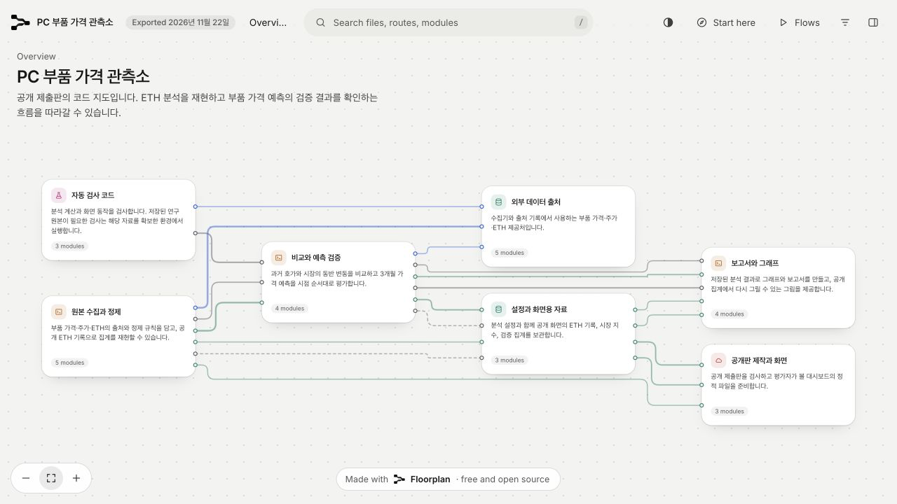
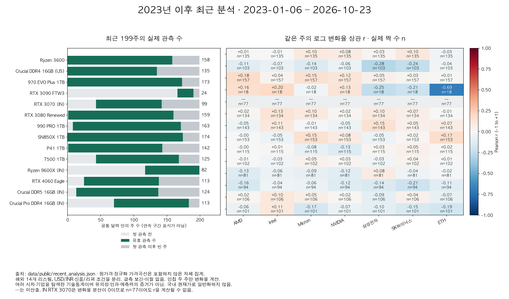

# PC 부품 가격 관측소

## [PC 부품 가격 관측소 서비스 바로 열기](https://pc-parts-observatory-mvp.freud-research.chatgpt.site)

**PC를 업그레이드할 때, 지금 살까 아니면 기다릴까?** CPU·RAM·SSD·GPU의 가격 기록을 모아 동급 제품을 비교하고, 3개월 뒤 가격 방향을 구매에 참고해도 될 만큼 예측할 수 있는지 검증했습니다.

**11월 동향:** 미국 소매 신품 지수는 30일 동안 GPU **+10.6%**, CPU **−1.9%**로 엇갈렸습니다. 3개월 예측은 별도 검증에서 35개 가격 계열 모두 구매 추천 기준을 통과하지 못했습니다.

[**공개 대시보드 바로 열기**](https://highslow1536.github.io/Codyssey-M1-1/) · [**코드 구조 지도**](https://highslow1536.github.io/Codyssey-M1-1/floorplan/) · [**분석 보고서**](REPORT.md#0-30초-요약-그래서-지금-사도-될까) · [**데이터와 재현**](docs/reproduction.md) · [**과제 제출 체크표**](docs/submission_checklist.md)

[](https://highslow1536.github.io/Codyssey-M1-1/floorplan/)


| **199주** | **21개** | **모델 5종 · 35계열** | **1,096일** |
| --- | --- | --- | --- |
| 해외 부품 14종과 주가 6종·ETH를 비교한 주간 범위 | 배송비와 판매처 조건을 확인한 국내 비교 대상 | 3개월 예측 모델과 검증에 사용한 제품별 가격 계열 | 공개 데이터로 직접 재현할 수 있는 ETH 일별 기록 |

## 데이터에서 발견한 세 가지

- **2026-10-23 국내 연구 스냅샷에서 같은 GPU 칩의 견적이 22.6% 차이 났습니다.** RTX 5070 Ti 한 제품의 배송 포함 견적은 다른 네 제품의 중앙값보다 22.6% 높았습니다. 공개판에서 당시 비교 기준과 집계 차이율을 확인할 수 있습니다. [국내 견적 비교와 검증 범위](REPORT.md#56-현재-동급-비교와-미래-구매-시점은-별도-판단이다)
- **미국 RAM 지수는 기간에 따라 방향이 달랐습니다.** DDR5와 DDR4는 30일로 보면 각각 **+2.7%**, **+1.4%**였지만 최근 7일에는 둘 다 **−0.5%**였습니다. [11월 미국 부품 지수 5개](docs/market_price_snapshot.md) · [별도 기록: 10월 해외 14개 제품](docs/recent_analysis.md)
- **3개월 구매 추천 기준을 통과한 계열은 0/35였습니다.** 로지스틱 회귀부터 ARIMA·SARIMA·ETS까지 다섯 모델을 과거에서 미래 순서로 검증했습니다. 단순 기준보다 안정적으로 나은지, 표본이 충분한지, 확률을 믿을 수 있는지를 따로 확인하고 구매 추천을 보류했습니다. [모델 비교 점수와 보류 이유](docs/model_comparison.md)

> **11월 지수 기준:** 실제 가격 관측일 **2026-11-11 (미국 동부)** · 자료 수집일 **2026-11-14 (한국)**. [Pricify 공개 지수](https://pricify.ai/indices)에서 7일·30일 변화율과 관측 제품 수만 가져왔습니다. 기존 14개 제품의 주간 분석은 **2026-10-23 종료 주**, 예측 검증 기준은 **2026-10-23**입니다. 두 가격 자료는 별도이며 자동 갱신되지 않습니다.

## 과제 평가항목과 확인 근거

| 필수 평가항목 | 공개판에서 확인할 수 있는 내용 | 근거 |
| --- | --- | --- |
| 시계열 데이터 100점 이상, 출처·기간 명시 | Coin Metrics의 **ETH 일별 가격 1,096점**을 공개합니다. 관측 기간은 2020-01-01~2022-12-31이며, 자료는 CC BY-NC 4.0 조건을 따릅니다. | [ETH 일별 CSV](data/processed/2026-10-22/crypto/eth_daily.csv) · [열과 관측 수](REPORT.md#32-공개-eth-스키마와-결측) |
| 분석 질문 3개 이상 | 부품 가격 추세, 주가와의 동반 변동, 채굴 전후 GPU 가격, 국내 동급 견적, 3개월 가격 방향의 **5개 질문**을 정의했습니다. | [질문과 확인 방법](REPORT.md#2-분석-질문) |
| 데이터 정제와 시계열 기법 2개 이상 | 가격 결측 주는 빈칸으로 두고 0 이하의 가격은 제외 후 사유를 기록했습니다. ETH 채굴 수익 대용은 전환일 1일과 채굴 종료 뒤 107일을 ‘해당 없음’으로 남겼습니다. ETH **30일 이동평균**으로 추세를, **인접 주 변화율**로 단기 변동을 확인했습니다. | [정제 기준](REPORT.md#41-가격-정의와-이상값) · [기법과 선택 이유](REPORT.md#42-시계열-분석-기법과-선택-이유) |
| 리포트 내 시각화 2개 이상, 3개 이상 권장 | ETH 가격·이동평균과 주간 변화율, 부품별 관측 수와 상관, 예측 오차 등 **분석 그래프 11장**을 보고서에 넣었습니다. 각 그림에 단위와 읽는 방법을 제시합니다. | [분석 결과와 시각화](REPORT.md#5-분석-결과와-시각화) · [예측 결과](docs/model_comparison.md#2-전체-요약) |
| 근거 있는 인사이트 3개 이상, 결론과 한계 | **인사이트 8개**에서 관찰과 해석을 구분했습니다. 예를 들어 ETH는 2021년 장기 상승 중에도 주간 변화율 표준편차가 15.95%p였습니다. 장기 방향과 단기 변동을 따로 읽었습니다. | [ETH 연도별 통계](data/public/eth_yearly_summary.csv) · [인사이트](REPORT.md#7-인사이트-관찰해석행동-구분) · [결론과 한계](REPORT.md#8-결론과-한계) |
| Python 3.10 이상, 코드·의존성·실행·출처 | Python **3.12.14**에서 검증했습니다. 의존성과 오프라인 ETH 재현 순서, 수집 출처와 이용 범위를 공개합니다. 부품 예측 모형을 재학습하려면 별도로 허가된 원본이 필요합니다. | [코드](scripts/) · [의존성](requirements-analysis.txt) · [설치·ETH 재현 명령](#python-312-설치와-eth-재현) · [데이터 안내](data/README.md) |
| AI 사용 로그 | Codex를 사용한 작업, 사용 이유, 검증 방법을 기록했습니다. 예를 들어 전처리 코드는 원본 해시, 계산식, 주 경계, 결측 검사를 통해 확인했습니다. | [AI 사용 로그](REPORT.md#11-ai-사용-로그) |
| GitHub 제출 | 공개 저장소에 보고서, 코드, 공개 가능한 자료와 수집 방법을 담았습니다. | [공개 저장소](https://github.com/highslow1536/Codyssey-M1-1) · [공개 제출 체크표](docs/submission_checklist.md) |

**보너스 과제**

- 대시보드 스크린샷 3장과 조작 시나리오를 제공합니다. ETH 전체 가격에서 2022년과 수익 대용 지표를 선택하면 관측 수와 공백이 어떻게 달라지는지 확인할 수 있습니다. [화면과 조작 시나리오](REPORT.md#부록-a-공개-대시보드-화면과-조작-시나리오)
- 3개월 가격 방향을 시간순으로 검증해 과거 방향 빈도·가격 유지 기준과 비교했습니다. 오차와 실제 평가 표본을 그림에 표시했으며, **35개 계열 중 추천 기준을 통과한 계열은 0개**였습니다. [예측 검증과 한계](REPORT.md#6-3개월-가격-방향-모형과-검증-결과)

## 1. 바로 실행하기

**[GitHub Pages에서 대시보드 열기](https://highslow1536.github.io/Codyssey-M1-1/)** — 설치나 로그인 없이 브라우저에서 바로 볼 수 있습니다.


첫 화면에서는 **미국 부품 가격 지수**와 **3개월 예측의 구매 추천 기준 통과 결과**를 한눈에 볼 수 있습니다. 부품 5개 지수와 관측 제품 수를 펼쳐 보고, **예측 검증**에서 오차와 단순 기준을 비교할 수 있습니다. **ETH 추이**는 별도 탭에 있습니다. [화면 예시와 조작 순서](REPORT.md#부록-a-공개-대시보드-화면과-조작-시나리오)

로컬에서 실행하는 방법은 [공개판 재현 안내](docs/reproduction.md#1-화면-보기)를 참고하세요.

## 어떻게 만들었나요?

**수집 → 점검 → 분석 → 검증 → 대시보드.** 가격마다 통화·배송비·상품 조건을 확인하고, 관측이 비어 있는 날짜를 그대로 남겼습니다. 가격 수준이 비슷하게 움직이는지와 매주 변화 방향이 같은지를 따로 계산했습니다. 예측에는 해당 시점까지 알 수 있던 정보만 넣고, 가격 유지와 과거 방향 빈도를 기준으로 비교했습니다.



**10월 분석 기록:** 왼쪽은 199주 중 실제 가격을 확보한 주 수, 오른쪽은 시장 지표와 같은 주에 얼마나 함께 움직였는지와 실제 비교 횟수입니다. [관측 범위·출처별 최신성](docs/recent_analysis.md) · [공개 집계 CSV](data/public/recent_correlations.csv)

## 데이터와 재현

| 찾는 자료 | 어디서 보나요? |
| --- | --- |
| 전체 분석과 그래프 11장, AI 사용 로그 | [REPORT.md](REPORT.md) |
| ETH 원자료와 분석을 다시 실행하는 방법 | [공개판 재현 안내](docs/reproduction.md) · [ETH 일별 CSV](data/processed/2026-10-22/crypto/eth_daily.csv) |
| 분석 코드와 설정, 검사 | [scripts](scripts/) · [config](config/) · [tests](tests/) |
| 예측 평가 지표와 단계별 규칙 | [35계열 집계](data/analysis/2026-10-23/forecast/forecast_metrics.csv) · [검증 규약](docs/forecast_protocol.md) |

### Python 3.12 설치와 ETH 재현

macOS에서 Homebrew를 사용한다면 아래 명령으로 Python 3.12를 설치합니다. [Homebrew 설치 안내](https://formulae.brew.sh/formula/python@3.12) · [Python 공식 다운로드](https://www.python.org/downloads/)

```bash
brew install python@3.12
```

Python 3.12를 설치한 뒤 저장소 루트에서 아래 명령을 실행합니다(macOS·Linux 기준). 검증에 사용한 버전은 **3.12.14**입니다.

```bash
python3.12 -m venv .venv
.venv/bin/python -m pip install -r requirements-analysis.txt
.venv/bin/python scripts/prepare_eth_mining.py
.venv/bin/python scripts/build_public_eth_analysis.py
```

두 분석 스크립트는 저장된 공개 자료로 ETH 일별·주별 CSV, 집계와 그래프를 다시 생성합니다. 2021년과 2022년 ETH 주간 변화율 표준편차 **15.95%p·11.65%p**를 결과에서 확인할 수 있습니다. [연도별 집계 CSV](data/public/eth_yearly_summary.csv) · [ETH 분석과 그림 1·2](REPORT.md#52-공개-eth-가격-추세와-단기-변동이-다르다) · [생성 파일과 글꼴 안내](docs/reproduction.md#4-eth-분석-재생성)

### 국내 견적과 GPU 사례의 검증 범위

공개판에는 2026-10-23 국내 견적의 비교 기준과 집계 차이율, 이더리움 머지 전후 GPU 사례의 조사일·비교 기간·증감률을 담았습니다. 차이율과 증감률을 다시 계산하려면 이용 권한이 있는 당시 국내 원견적·GPU 소매 호가·eBay 월별 가격이 필요합니다. 국내 성능 대비 가격을 재현하려면 벤치마크 입력도 필요합니다. Coin Metrics의 공개 ETH 자료에는 **CC BY-NC 4.0**이 적용됩니다. [국내 견적 사례](REPORT.md#56-현재-동급-비교와-미래-구매-시점은-별도-판단이다) · [GPU 가격 사례](REPORT.md#55-20202022-채굴-사례-gpu-채굴-붐-머지-전에-이미-하락했다) · [데이터 공개 범위](data/README.md) · [권리 안내](RIGHTS.md)
