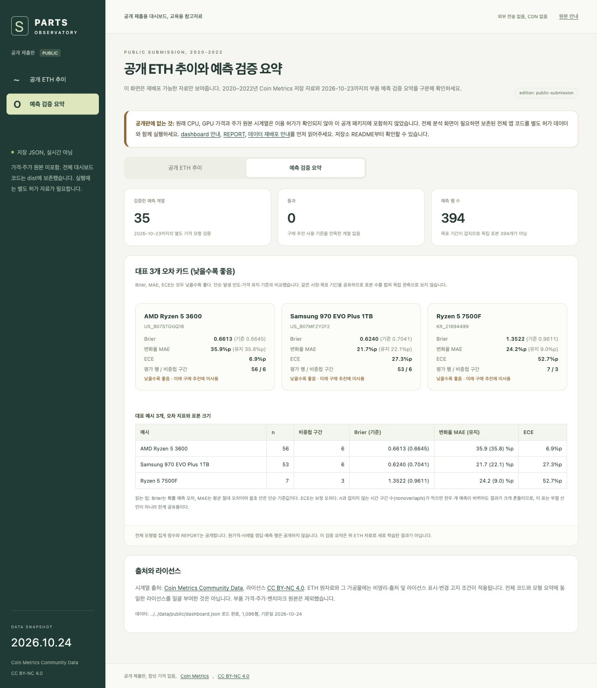

# PC 부품 가격 관측소

**PC를 업그레이드할 때, 지금 살까 아니면 기다릴까?** CPU·RAM·SSD·GPU의 가격 기록을 모아 동급 제품을 비교하고, 3개월 뒤 가격 방향을 구매에 참고해도 될 만큼 예측할 수 있는지 검증했습니다.

**결론:** 같은 RTX 5070 Ti에서도 배송 포함 견적이 22.6% 차이 났습니다. 3개월 예측은 35개 가격 계열 모두 구매 추천 기준을 통과하지 못했습니다.

[**분석 보고서**](REPORT.md#0-30초-요약-그래서-지금-사도-될까) · [**대시보드 둘러보기**](#1-바로-실행하기) · [**데이터와 재현**](docs/reproduction.md) · [**과제 제출 체크표**](docs/submission_checklist.md)


| **199주** | **21개** | **모델 5종 · 35계열** | **1,096일** |
| --- | --- | --- | --- |
| 해외 부품 14종과 주가 6종·ETH를 비교한 주간 범위 | 배송비와 판매처 조건을 확인한 국내 비교 대상 | 3개월 예측 모델과 검증에 사용한 제품별 가격 계열 | 공개 데이터로 직접 재현할 수 있는 ETH 일별 기록 |

## 데이터에서 발견한 세 가지

- **같은 GPU 칩인데 견적이 22.6% 달랐습니다.** RTX 5070 Ti 한 제품의 배송 포함 견적은 다른 네 제품의 중앙값보다 22.6% 높았습니다. 같은 칩을 고른 뒤에도 보드와 판매처를 비교할 이유가 있었습니다. [국내 견적 비교](REPORT.md#56-현재-동급-비교와-미래-구매-시점은-별도-판단이다)
- **같은 RAM이라도 가격 방향은 달랐습니다.** 분석 마지막 13주 동안 인도 판매처의 두 제품에서 DDR5 호가는 44.68% 오르고 DDR4 호가는 6.02% 내렸습니다. 제품과 기간을 바꾸면 주가와의 관계도 달라, 주가만으로 구매 시점을 정할 근거는 부족했습니다. [최근 199주 결과](docs/recent_analysis.md)
- **3개월 구매 추천 기준을 통과한 계열은 0/35였습니다.** 로지스틱 회귀부터 ARIMA·SARIMA·ETS까지 다섯 모델을 과거에서 미래 순서로 검증했습니다. 단순 기준보다 안정적으로 나은지, 표본이 충분한지, 확률을 믿을 수 있는지를 따로 확인하고 구매 추천을 보류했습니다. [모델 비교 점수와 보류 이유](docs/model_comparison.md)

> **관측 기준:** 주간 분석은 2023-01-06부터 2026-10-23까지이며 제품별 실제 관측은 24~174주입니다. 마지막 재수집은 2026-10-25, 예측 스냅샷은 2026-10-23입니다. 데이터는 자동 갱신되지 않습니다.

## 1. 바로 실행하기



공개 화면에서 **ETH 추이**의 연도와 지표를 바꿔 보고, **예측 검증 요약**에서 제품별 오차와 기준 점수를 비교할 수 있습니다. [화면 예시와 조작 순서](REPORT.md#부록-a-공개-대시보드-화면과-조작-시나리오)

1. GitHub에서 **Code → Download ZIP**으로 저장소를 내려받아 압축을 풉니다.
2. 터미널에서 압축을 푼 폴더로 이동해 아래 명령을 실행합니다. 화면을 보는 데 추가 라이브러리는 필요 없습니다.

   ```bash
   python3 -m http.server 8766 --bind 127.0.0.1
   ```

3. 브라우저에서 [공개 대시보드 열기](http://127.0.0.1:8766/dashboard/public/)를 누릅니다. 종료는 터미널에서 `Ctrl+C`입니다.

## 어떻게 만들었나요?

**수집 → 점검 → 분석 → 검증 → 대시보드.** 가격마다 통화·배송비·상품 조건을 확인하고, 관측이 비어 있는 날짜를 그대로 남겼습니다. 가격 수준이 비슷하게 움직이는지와 매주 변화 방향이 같은지를 따로 계산했습니다. 예측에는 해당 시점까지 알 수 있던 정보만 넣고, 가격 유지와 과거 방향 빈도를 기준으로 비교했습니다.


왼쪽은 199주 중 실제 가격을 확보한 주 수, 오른쪽은 시장 지표와 같은 주에 얼마나 함께 움직였는지와 실제 비교 횟수입니다. [관측 범위·출처별 최신성](docs/recent_analysis.md) · [공개 집계 CSV](data/public/recent_correlations.csv)

## 데이터와 재현

| 찾는 자료 | 어디서 보나요? |
| --- | --- |
| 전체 분석과 그래프 11장, AI 사용 로그 | [REPORT.md](REPORT.md) |
| ETH 원자료와 분석을 다시 실행하는 방법 | [공개판 재현 안내](docs/reproduction.md) · [ETH 일별 CSV](data/processed/2026-10-22/crypto/eth_daily.csv) |
| 분석 코드와 설정, 검사 | [scripts](scripts/) · [config](config/) · [tests](tests/) |
| 예측 평가 지표와 단계별 규칙 | [35계열 집계](data/analysis/2026-10-23/forecast/forecast_metrics.csv) · [검증 규약](docs/forecast_protocol.md) |

공개 데이터로 ETH 분석과 부품 분석의 집계 그림을 재현할 수 있습니다. 부품 가격·주가·벤치마크 원본 및 이를 복원할 수 있는 자료는 공개판에서 제외했습니다. 실제 부품 모델을 다시 학습하거나 국내 견적 비교 화면을 실행하려면 별도로 허가된 입력이 필요합니다. Coin Metrics의 ETH 자료에는 **CC BY-NC 4.0**이 적용됩니다. [공개 범위와 제외 자료](data/README.md) · [권리 안내](RIGHTS.md)
