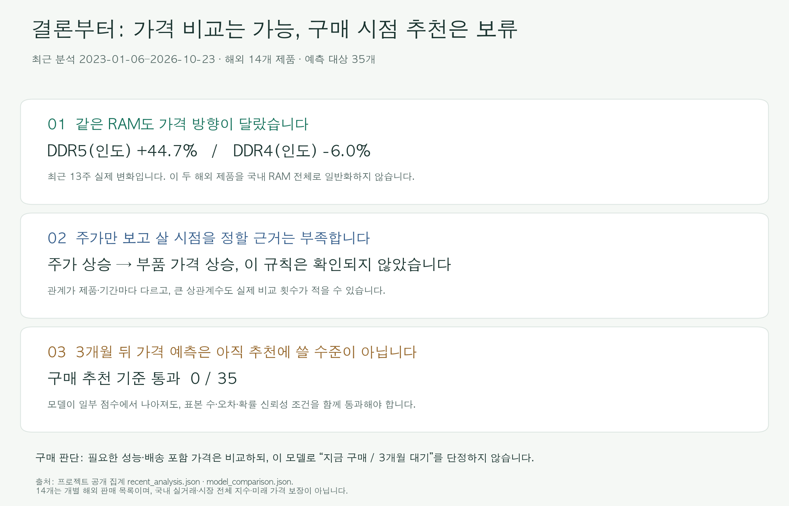
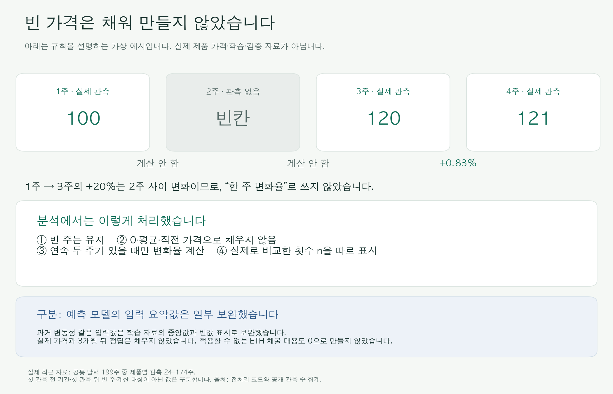

# PC 부품 가격 추이와 구매 시점 판단을 위한 데이터 분석

**제출 보고서 · 공개판** · 최근 재수집·문서 갱신 2026-10-25 · 주간 분석 10-23까지 · 예측 입력 10-23 고정 · 권리 점검 10-24 · [README](README.md) · [GitHub 저장소](https://github.com/highslow1536/Codyssey-M1-1)

## 0. 30초 요약: 그래서 지금 사도 될까?

**현재 가격을 비교하는 데에는 쓸 수 있지만, 이 분석만으로 “지금 사라 / 3개월 기다려라”를 권할 단계는 아니다.**

| 궁금한 점 | 이번 분석의 결론 |
|---|---|
| 요즘 부품 가격이 모두 오르나? | **제품마다 다르다.** 최근 13주에 인도 Crucial DDR5는 +44.68%, Crucial Pro DDR4는 -6.02%였다. 두 해외 제품의 결과이며 국내 RAM 전체를 뜻하지 않는다. |
| 제조사 주가를 보면 구매 시점을 알 수 있나? | **안정적인 신호를 확인하지 못했다.** 가격이 함께 움직이는 정도가 제품·기간마다 달랐다. |
| 3개월 가격 예측은 믿고 써도 되나? | **추천은 보류한다.** 35개 제품별 가격 자료 중 표본 수·오차·확률 신뢰성 기준을 모두 통과한 계열은 0개였다. |

**분석 범위:** 최근 동향은 2023-01-06–2026-10-23의 **199주 달력**, 해외 부품 **14개**, 주가 6종과 ETH다. 제품별 실제 가격 관측은 **24–174주**로 다르다. 10월 25일에 재조회했지만, 모든 제품에 그날 가격이 있는 것은 아니다. 2020–2022년 자료는 채굴 붐의 과거 사례로 따로 사용했다.

**결측치(있어야 할 값이 비어 있는 경우)는 어떻게 했나?**

> **실제 가격과 미래 정답은 채우지 않았다.** 빈 주는 그대로 두고, 연속 두 주에 가격이 있을 때만 변화율을 계산했다. 예외적으로 모델에 넣는 과거 변동성 같은 **입력 요약값**은 학습 자료의 중앙값으로 보완하고 빈값이었다는 표시를 함께 넣었다.

**읽는 순서:** [결측 처리 표](#4-전처리와-분석-방법) → [가격·주가·채굴 분석 결과](#5-분석-결과와-시각화) → [예측이 추천 기준을 통과하지 못한 이유](#6-3개월-가격-방향-모형과-검증-결과) → [최종 결론](#8-결론과-한계). 계산식과 검증 점수는 펼쳐서 읽는 상세 설명에 두었다.

## 1. 분석 주제와 선정 이유

PC 업그레이드를 준비할 때는 “어떤 제품이 싼가?”와 “지금 살까, 기다릴까?”를 함께 판단해야 한다. 이 프로젝트는 CPU·RAM·SSD·GPU의 가격 흐름을 살펴보고, 제조사 주가와 과거 채굴 수요가 가격 변화를 설명하는 데 도움이 되는지 확인했다. 마지막으로 3개월 뒤 가격을 예측해 구매 시점을 권할 만큼 믿을 수 있는지도 검증했다.

**현재 제품 비교, 과거 원인 탐색, 미래 예측은 각각 다른 질문이다.** 싸게 보이는 제품이 앞으로도 오를 것이라는 뜻은 아니고, 주가와 가격이 함께 움직였다고 해서 주가가 가격을 바꿨다는 뜻도 아니다.

**그림을 보는 법:** 자료를 모은 뒤 가격의 의미와 빈값을 확인하고, 같은 주 단위로 맞춰 분석했다. 마지막에는 과거 자료로 학습한 모델을 그보다 뒤의 기간에서 평가했다.

## 2. 분석 질문

| 번호 | 알고 싶은 것 | 확인한 방법 |
|---|---|---|
| Q1 | 부품별 가격이 어떻게 변했고, 최근에는 무엇이 다른가? | 실제 관측 주 수와 기간별 변화 비교 |
| Q2 | 부품 가격과 관련 주가는 함께 움직이거나 한쪽이 먼저 움직이나? | 같은 주와 최대 8주 앞뒤의 가격 변화 비교 |
| Q3 | GPU는 채굴 붐과 이더리움 머지 전후에 어떻게 변했나? | 실제 조사일·월별 가격의 전후 비교 |
| Q4 | 판매처가 적거나 유난히 비싼 제품을 빼면 가성비 판단이 달라지나? | 배송 포함 복수 판매처 가격과 동급 제품 비교 |
| Q5 | 3개월 뒤 가격 예측을 구매 추천에 쓸 만큼 믿을 수 있나? | 과거로 학습하고 이후 기간에서 단순 기준과 비교 |

## 3. 데이터 설명

### 3.1 연구 전체와 공개판의 범위

**달력의 길이와 실제 확보한 가격 수는 다르다.** 아래의 199주는 비교용 기간이며, 모든 제품의 가격이 199개 있다는 뜻이 아니다.

| 자료 | 분석 기간 | 실제 확보 범위·주의점 |
|---|---|---|
| 최근 해외 부품 14개 | 2023-01-06–2026-10-23 | CPU·RAM·SSD·GPU, 제품별 24–174주. 미국·인도, 신품·리퍼를 구분 |
| 최근 주가 6종·ETH | 같은 199주 | 시장별 가격 199주·인접 주 변화 198개. 주가는 각 거래소의 현지 통화 |
| 국내 제품 비교 | 2026-10-23 기준 21개 제품 | 최초 8개 견적은 10-25 재조회. 현재 견적과 과거 차트는 이어 붙이지 않음 |
| 과거 채굴·가격 사례 | 2020–2022년 | CPU·SSD 156주 달력, GPU 소매 조사와 eBay 월별 자료, ETH 일별 1,096개 |
| 3개월 예측 검증 | 10-23 입력 자료로 고정 | 국내 21개+해외 14개=35개 계열. 전체 평가 394건이 모두 독립된 실험은 아님 |

**날짜도 구분했다.** 수집일은 사이트를 조회한 날이고, 실제 관측일은 가격이 기록된 날이다. Ryzen 3600의 마지막 원출처 호가는 **10월 6일**, 970 EVO Plus는 **9월 26일**이다. 10월 25일에 재조회했다고 오늘 가격으로 바꾸지 않았다. [14개 제품의 기간·관측 수 전체 표](docs/recent_analysis.md)

> **공개 자료 안내:** 재배포 조건을 확인한 ETH 자료와 코드·방법·자체 집계 결과를 GitHub에 담았다. 부품 원가격·주가·벤치마크 원본은 제외했다. 따라서 공개판만으로 전체 부품 모델을 다시 학습할 수는 없다. [공개 범위](data/README.md) · [출처별 조건](docs/data_redistribution.md)

과제의 **시계열 100점 이상** 조건은 공개 ETH 일별 자료 1,096점으로 충족한다. GPU의 빈 날짜를 채워서 관측 수를 늘린 것은 아니다.

### 3.2 공개 ETH 스키마와 결측

ETH는 **가격 1,096일이 모두 있고**, 채굴 수익을 간접 계산한 지표는 988일만 계산된다. 나머지 108일은 데이터 수집 실패가 아니라 **전환일 1일+기존 채굴 방식(PoW) 종료 뒤 107일**이다. 이 값은 “해당 없음”으로 두었다.

ETH 컬럼과 계산 가능한 날짜 수 자세히 보기

| 컬럼 | 뜻 | 유효 수 |
|---|---|---:|
| `date`, `price_usd` | 날짜·ETH 가격(USD) | 1,096일 |
| `hashrate_ths`, `fee_tot_ntv`, `iss_tot_ntv`, `iss_tot_usd` | 네트워크 연산력·수수료·발행량 | 원본 필드·단위 대조 |
| `rev_usd_per100mh_gross`, `iss_usd_per100mh` | 고정 연산력으로 환산한 수익 대용 A·B | 각 988일 |
| `is_partial_transition`, `pow_terminated` | 전환일·채굴 종료 여부 | 1일·107일 |
| `source_file`, `source_sha256` | 원본 파일·내용 확인용 해시 | 행별 추적 |

[ETH 산식·편향](docs/eth_mining_data_basis.md) · [공개 일별 CSV](data/processed/2026-10-22/crypto/eth_daily.csv)

## 4. 전처리와 분석 방법

### 4.1 가격 정의와 이상값

**핵심 원칙은 “빈 가격을 만들어 넣지 않고, 비교할 수 있는 값끼리만 비교한다”이다.**

| 만난 문제 | 실제로 한 처리 | 그렇게 한 이유 |
|---|---|---|
| 가격이 없는 주 | **빈칸 유지.** 0·평균·직전 가격으로 채우지 않음 | 관측하지 않은 가격을 실제 가격처럼 만들지 않기 위해 |
| 중간 한 주가 비어 있음 | 그 주와 다음 주의 **주간 변화율은 계산하지 않음** | 두 주 사이 변화를 한 주 변화로 잘못 세지 않기 위해 |
| 첫 가격 기록 전의 빈 기간 | 관측 시작 뒤 빈 주와 **따로 집계** | 미출시·미등록·미추적 중 무엇인지 알 수 없기 때문에 |
| 주가·부품 중 한쪽만 값이 있음 | 두 값이 모두 있는 날짜 쌍만 비교하고 **실제 횟수 n 표시** | 주가 데이터가 많아도 부품 관측이 늘어나는 것은 아니기 때문에 |
| 아직 끝나지 않은 주·달 | 최근 분석·예측에서 **완료된 기간만 사용** | 며칠치 값과 한 주·한 달 전체를 섞지 않기 위해 |
| 0·음수 등 유효하지 않은 가격 | 제외 사유를 남김. 최근 분석·예측의 USD 5달러 미만도 별도 규칙으로 제외 | 가격 조건을 확인할 수 없는 값의 영향을 줄이기 위해. 양수 급등을 일괄 삭제하지는 않음 |
| ETH 채굴 종료 뒤 수익 대용 | **“해당 없음”으로 유지**. 0원으로 바꾸지 않음 | 더 이상 같은 방식으로 계산할 수 없는 값이기 때문에 |
| 예측 모델의 입력 요약값이 비어 있음 | **학습 자료의 중앙값+빈값 표시**로 보완 | 입력 계산을 가능하게 하되 실제 가격·미래 정답은 건드리지 않기 위해 |
| 국내 판매처·가격 기준이 다름 | 배송 포함 가격으로 비교. 3개 판매처 미만은 산정 보류. PC·모바일 차이를 임의 평균내지 않음 | 배송비·회원가·희소 판매처가 가성비 순위를 왜곡할 수 있기 때문에 |

**실제로 남은 데이터의 예:** 199주 중 Ryzen 3600은 가격이 158주 있지만, 연속 두 주를 비교할 수 있는 횟수는 **135개**다. Ryzen 9600X는 첫 관측 전 117주와 관측 82주를 구분했다. 첫 관측 전 117주를 모두 품절로 해석하지 않았다.

[해외 전처리 상세](docs/overseas_preprocessing.md) · [국내 PC·모바일 감사](docs/domestic_price_audit.md) · [예측 입력 규칙](docs/forecast_protocol.md)

### 4.2 시계열 분석 기법과 선택 이유

| 한 일 | 쉬운 설명 | 읽을 때 주의할 점 |
|---|---|---|
| 추세 보기 | 일별 변동을 줄이려고 ETH의 30일 평균을 함께 표시 | 30개 날짜가 모두 있어야 계산. 미래 예측선이 아님 |
| 변화율 비교 | “얼마였나”와 별도로 “직전 주보다 얼마나 변했나”를 비교 | 빈 주를 건너뛰지 않음. 부품·주가는 로그 변화율 사용 |
| 상관·시차 비교 | 두 가격 변화가 함께 움직이는지, 최대 8주 먼저 움직이는지 확인 | 함께 움직여도 원인·구매 신호가 증명되는 것은 아님 |
| 채굴 전후 비교 | 2022년 7·8월과 10·11월 평균을 비교하고 전환월 9월 제외 | 전후 각 2개월뿐. 다른 요인을 통제한 실험이 아님 |
| 예측 검증 | 과거 자료로 학습하고 더 뒤의 실제 결과와 대조 | 쉬운 기준보다 낫고 오차·표본 조건도 충족해야 추천에 사용 |

주 단위는 **토요일–금요일**로 맞췄다. 부품은 그 주 마지막 실제 호가, 주가는 마지막 거래일의 수정주가를 썼다. 통화·국가·신품/리퍼 가격을 한 곡선으로 합치지 않았다.

상관계수·변화율·검정의 뜻과 기간 구분

- `n`은 실제 비교한 날짜 쌍 수다. 전체 달력 주 수와 다르다.
- 상관계수 `r`은 -1부터 +1까지다. +1에 가까우면 같은 방향, -1에 가까우면 반대 방향, 0에 가까우면 뚜렷한 직선 관계가 약하다.
- 로그 변화율은 `ln(이번 주 가격 / 직전 주 가격)`이다. 시차가 +L이면 주가를 L주 먼저 놓고 비교한다.
- 2020–2022년의 204개 시차 비교에는 블록 기반 불확실성 분석과 BH·BY 다중 비교 보정을 했다. 보정 뒤 유의한 결과는 0개였다.
- 최근 2023–2026년의 1,666행은 탐색 통계다. 과거 기간의 검정 결과를 최근 기간에 적용하지 않았다.
- 장기 방향은 추세, 비슷한 시기에 반복되는 패턴은 계절성, 그 밖의 불규칙한 변동은 노이즈로 구분했다. 반복 가능한 계절 효과가 확인됐다고 주장하지 않는다.

### 4.3 ETH 수익 대용

**수익 대용은 ETH 네트워크 자료로 간접 계산한 참고 지표이며, 그래픽카드의 실제 순이익이 아니다.** 전기요금·카드 소비전력·풀 수수료를 반영하지 않았다. 2022년 9월 머지 뒤에는 같은 PoW 채굴 계산을 연장하지 않았다.

수익 대용 A·B의 산식과 한계

A는 `(발행 ETH+총 수수료 ETH) × ETH USD 가격 ÷ 네트워크 해시율`을, B는 발행분만을 고정 100 MH/s로 환산한다. TH/s를 MH/s로 변환한다. London 뒤 A에는 소각되는 수수료가 포함되고 Beacon 이후에는 스테이킹 발행이 혼입된다. 따라서 A·B를 실제 GPU 수익의 엄밀한 상·하한으로 해석하지 않는다.

## 5. 분석 결과와 시각화

### 5.1 최근 14개 부품·7개 시장의 동향과 동반 변동 (2023–2026)

**결론: 최근 가격 방향은 제품별로 달랐고, 주가로 구매 시점을 정할 만큼 일관된 관계는 확인하지 못했다.**

| 최근 13주에 실제로 변한 정도 | 변화율 | 해석 |
|---|---:|---|
| Ryzen 9600X (인도) | +2.85% | 이 제품의 등록 호가는 소폭 상승 |
| Crucial DDR5 16GB (인도) | +44.68% | 이 제품은 크게 상승 |
| Crucial Pro DDR4 16GB (인도) | -6.02% | 같은 RAM 분류 안에서도 다른 방향 |
| RTX 3070 (인도) | 0.00% | 기록된 호가가 동일. 시장 전체 가격 안정의 증거는 아님 |

양 끝 주에 실제 가격이 있는 **4개 제품만** 계산했다. 나머지 10개는 한쪽 이상이 없어 계산하지 않았다. 이는 지난 13주의 관찰이며, **앞으로 3개월 예측이 아니다.** 서로 다른 제품의 결과를 국내 DDR4/DDR5 전체의 차이로 일반화하지 않는다.

**그림 R1 · 어디를 볼까?** 왼쪽은 실제 가격을 확보한 주 수다. 오른쪽의 `r`은 같은 주 가격 변화가 함께 움직인 정도다. +1 쪽은 같은 방향, -1 쪽은 반대 방향, 0 근처는 뚜렷한 직선 관계가 약하다는 뜻이다. `n`은 실제 비교 횟수다. 빈칸·미산출은 0이 아니다. 예를 들어 인도 RTX 3070은 기록된 가격이 변하지 않아 비교 횟수 77개가 있어도 상관계수를 계산할 수 없다.

**이 그림으로 알 수 있는 것:** Ryzen 9600X–AMD는 `r=-0.131(n=81)`, 990 PRO–삼성전자는 `+0.151(n=143)`이다. RTX 3090–ETH는 `-0.688`로 커 보이지만 실제 비교는 **18개뿐**이다. 큰 계수 하나를 미래 신호로 채택하지 않았다. [14개 제품 전체 표·관측일](docs/recent_analysis.md) · [98쌍·17시차 통계](data/public/recent_correlations.csv)

최신 자료도 제품마다 다르다. 구형 CPU·SSD의 호가는 각각 10월 6일·9월 26일에서 멈췄다. 10월 24일 토요일의 호가는 아직 끝나지 않은 다음 주에 속하므로 이번 주간 분석에 넣지 않았다. [조회 기록](data/public/source_freshness.json)

### 5.2 공개 ETH 가격: 추세와 단기 변동이 다르다

**과거 사례의 결론: 장기적으로 올랐던 해에도 한 주 한 주의 변동은 컸다.** ETH 분석은 GPU 가격이나 오늘의 구매 추천을 대신하지 않는다.

**그림 1 · 어디를 볼까?** 얇은 선은 매일 가격, 굵은 선은 30일 평균이다. 2021년 상승과 2022년 하락을 큰 흐름으로 볼 수 있다. 가격 1,096개, 30일 평균 1,067개다. 세로축은 USD다.

**그림 2 · 이 그림의 결론:** 큰 상승 추세가 있어도 단기 가격이 안정적이라는 뜻은 아니다. 막대는 직전 주보다 변한 비율(%), 실제 비교는 155개다. 2021년 주별 변화율의 표준편차는 15.95%p, 2022년은 11.65%p였다. [연도별 수치](data/public/eth_yearly_summary.csv)

### 5.3 채굴 대용: 종료 뒤 공백은 0원 수익이 아니다

**결론: 머지 뒤 선이 없는 것은 채굴 수익이 0원으로 관측됐기 때문이 아니라, 같은 계산을 적용할 수 없기 때문이다.**

**그림 3 · 어디를 볼까?** A는 발행+수수료, B는 발행만으로 계산한 참고 지표다. 둘 다 실제 카드 수익이 아니다. 988일은 계산했고 전환일 1일+종료 뒤 107일은 빈칸으로 두었다. 세로축은 USD/100 MH/s/일이다.

### 5.4 [2020–2022년 사례] 부품 가격·주가: 수준 상관과 변화율 상관은 다르다

**결론: 두 가격 곡선이 비슷해 보여도, 매주 함께 오르내린다는 뜻은 아니었다.**

**그림 4 · 어디를 볼까?** 실제 가격이 있는 부분과 없는 부분을 먼저 확인한다. 과거 CPU는 156주 중 148주, SSD는 135주만 가격이 있었다. 이 그림의 최근 기간은 이전 저장본인 198주 기준이다. 새 199주·14개 제품은 그림 R1을 따른다.

**그림 5 · 이 그림의 결론:** CPU–AMD는 가격 자체의 상관 `+0.538`이 매주 변화 비교에서는 `-0.046(n=140)`으로 바뀌었다. SSD–삼성전자도 `-0.374`에서 `-0.023(n=122)`으로 바뀌었다. 긴 상승·하락 방향이 겹친 것과 단기 변화가 연결된 것은 다르다. [계산 결과](data/analysis/2026-10-22/correlations.csv)

**그림 6 · 이 그림의 결론:** 주가를 최대 8주 먼저 놓고 비교해도 안정적인 선행 신호를 확인하지 못했다. 2개 부품×6개 기업×17시차=204번 비교했고, 여러 번 찾다 우연히 큰 값이 나올 가능성을 보정한 뒤 유의한 결과는 0개였다. 이 결론은 **2020–2022년 구간에만** 적용한다. [전체 시차 결과](data/analysis/2026-10-22/lag_correlations.csv)

### 5.5 [2020–2022 채굴 사례] GPU 채굴 붐: 머지 전에 이미 하락했다

**결론: GPU 가격은 이더리움 머지 전에 이미 크게 하락했다. “머지 때문에 전부 내렸다”라고 설명할 수는 없다.**

**그림 7 · 어디를 볼까?** GPU 소매 가격은 있는 주가 32·29·32주여도, 연속 두 주를 비교할 수 있는 횟수는 **1·0·1개**뿐이다. ETH 자료가 많다고 이 빈 주를 채우지는 않았다. 대신 실제 조사일 사이 변화와 eBay 월별 변화를 나눠 분석했다.

| GPU | 확보한 최고 소매 호가 → 머지 직전 | eBay 머지 전 평균 → 후 평균 | 전후 표본 |
|---|---:|---:|---|
| RTX 3070 | -61.3% | -19.5% | 각각 2개월 |
| RTX 3080 10GB | -73.4% | -15.1% | 각각 2개월 |
| RTX 3090 | -65.6% | -16.4% | 각각 2개월 |

소매는 2021-05-16과 2022-09-11의 확보 값, eBay는 2022년 7·8월과 10·11월 평균을 비교했다. 9월은 전환월이라 제외했다. 공급 회복·신제품·재고·환율을 분리하지 못했고, 조사 사이의 진짜 최고가도 모른다. 따라서 전후 차이는 관찰 결과이며 머지의 단독 효과가 아니다. [채굴 분석 상세](data/analysis/2026-10-22/gpu_mining/REPORT.md)

### 5.6 현재 동급 비교와 미래 구매 시점은 별도 판단이다

**결론: 같은 칩·용량의 제품끼리 비교하면 유난히 비싼 견적은 찾을 수 있다. 그 가격이 앞으로 내릴지는 별도 문제다.**

국내 비교 제품을 8개에서 21개로 늘렸다. 배송 포함 3개 판매처의 중앙값은 20개에서 계산했고, 희소·이상 견적을 제외한 비교 기준 제품은 19개였다. 같은 RTX 5070 Ti에서도 한 보드가 다른 네 제품 중앙값보다 **22.6%** 비쌌다. 실제 재고나 판매량까지 확인한 것은 아니다.

| 할 수 있는 비교 | 남아 있는 한계 |
|---|---|
| CPU·GPU 성능 대비 현재 견적 | CPU는 사용자 제출 점수, GPU는 같은 리뷰의 게임 상대성능. 사용 환경·냉각·보증 차이 존재 |
| RAM·SSD의 용량·규격·구성 | 공통 앱 실측을 확보하지 못해 정밀한 성능 가성비로 표현하지 않음 |
| 동급 제품을 바탕으로 한 참고 가격 | **현재 조건에서의 비교 기준이며 3개월 뒤 적정가가 아님**. 업그레이드 전체 비용도 미반영 |

[가격·성능 비교 방법](docs/domestic_value_methodology.md). 원견적·벤치마크 표와 이를 복원하는 화면은 재배포 조건 미확인으로 공개 제외했다.

## 6. 3개월 가격 방향 모형과 검증 결과

**결론: ARIMA·SARIMA·ETS까지 비교했지만, 구매 추천에 쓸 만큼 검증된 모델은 아직 없었다(0/35).**

| 확인한 것 | 쉬운 설명 | 결과 |
|---|---|---|
| 비교 대상 | 기존 로지스틱 회귀·랜덤포레스트에 ARIMA·SARIMA·ETS 추가 | 총 5종을 같은 예측 시점에서 비교 |
| 예측 목표 | 3개월 뒤 가격이 3% 넘게 오를지, 비슷할지, 3% 넘게 내릴지 | 주간은 달력 3개월 뒤 첫 금요일, 월간은 3개 달 뒤 |
| 비교가 공정한가? | 같은 제품·같은 예측 날짜의 실제 결과로 채점 | 후보 공통 평가 332건, 선택 모델 전체 평가 394건. 두 집계의 분모는 다름 |
| 단순한 방법보다 나은가? | 가격 유지·과거 상승/보합/하락 빈도와 비교 | 일부 점수만 개선. 과거 검증 기준으로 선택이 바뀐 계열은 2개 |
| 구매 추천에 쓸 수 있나? | 충분한 표본, 작은 오차, 말한 확률과 실제 결과의 일치까지 확인 | **35개 모두 전체 추천 기준 미통과** |

예를 들어 SSD는 방향 확률의 오차가 줄었지만, 서로 겹치지 않는 평가 기간은 6개뿐이었고 확률도 충분히 보정되지 않았다. **점수가 조금 좋아졌다는 사실과 믿고 구매할 수 있다는 판단은 다르다.** 추천을 보류한다는 것은 가격이 내릴 것이므로 기다리라는 뜻도 아니다.

모델 설정·검증 날짜·상세 점수와 그래프 펼쳐 보기

### 6.1 미래 누출을 막는 검증

**설명도.** 주간은 달력 3개월 뒤 이상 첫 금요일(13\~14주), 국내 월간은 3개 달 뒤를 목표로 한다. 변화율 -3% 미만=하락, ±3%=보합, +3% 초과=상승이다. 과거 변화율·변동성·가격 위치·관측률·관측 기간을 특징으로 사용했다.

후보는 분류 2종(L2 다항 로지스틱 회귀·제한한 랜덤포레스트)에 시계열 3종(ARIMA(1,1,0)+drift, SARIMA(1,1,0)(1,0,0,s), ETS(A,Ad,N) 로그가격)을 더한 5종이다. 시계열 모형은 같은 SKU의 로그가격만 쓰고 외부 변수를 넣지 않는다. 2023\~2024년 공통 과거 원점에서 모형·확률 온도를 선택하고 2025\~2026년은 최종 평가로 남겼다. 선택 자료가 부족한 계열은 기존 모형을 유지한다. 국내는 동일 월간 정의 21SKU 패널이며 같은 시점의 미래 정답을 함께 차단했다. 분기 학습은 분류 모형은 목표 기간까지 끝난 사례만, 시계열 모형은 분기 시작 전 관측 가격 전부로 적합한다(3개월 목표 성숙 조건 없음). 결측 중앙값도 학습 집합에서만 계산했다. 원가격·목표 결측을 채우거나 미래 주가·ETH를 쓰지 않았다. 2025\~2026년을 본 뒤 후보를 확장한 회고 비교이므로 시험 점수로 모형을 고르지 않았다.

현재 조회한 과거 이력의 회고 평가여서, 당시 실시간으로 저장된 데이터만으로 검증한 결과는 아니다. 공급자의 사후 수정·품절과 결측의 관계는 통제하지 못했다. 국내 최신 월간 목표는 월 버킷 기준으로 오늘부터 3개월과도 다르다. [사전 규약](docs/forecast_protocol.md)

### 6.2 단순 기준 대비 결과

**그림 8.** Brier는 확률 오차, MAE는 변화율 절대오차이며 낮을수록 좋다. 분류 2종에 시계열 3종을 더해 같은 공통 원점에서 비교한다. 기준은 과거 발생 빈도와 가격 유지다. 일부 점수 개선만으로 추천을 허용하지 않았다. 이 그림은 새 5후보 집계에서 그리며, 과거 2후보 수치는 아래 기존-선택 비교표에서 역사 기록으로만 인용한다.

| 대표 계열 | 선택 모형 | 공통 n / 비중첩 | Brier 선택 / 기준 | 변화율 MAE 선택 / 유지 |
|---|---|---:|---:|---:|
| 미국 Ryzen 5 3600 | ARIMA T4.0 | 37 / 5 | 0.6658 / 0.7031 | 32.8 / 32.6%p |
| 미국 970 EVO Plus 1TB | SARIMA T2.0 | 53 / 6 | 0.5875 / 0.7041 | 22.0 / 22.1%p |
| 국내 Ryzen 5 7500F | 로지스틱 T1.0 유지 | 7 / 3 | 1.3522 / 0.9611 | 24.2 / 9.0%p |

| 같은 공통 원점 비교 | 기존 | 선택 | Brier 기존→선택 | MAE 기존→선택 |
|---|---|---|---:|---:|
| Ryzen 5 3600 (n=37) | forest T4.0 | ARIMA T4.0 | 0.6661→0.6658 | 32.6→32.8%p |
| 970 EVO Plus (n=53) | forest T4.0 | SARIMA T2.0 | 0.6240→0.5875 | 21.7→22.0%p |
| 7500F (n=7) | logistic T1.0 | 유지(선택 자료 없음) | 1.3522→1.3522 | 24.2→24.2%p |

CPU는 선택 변경에도 같은 원점 차이가 0.0003에 불과하다. 두 모형 간 paired 우위 검정은 수행하지 않았으며, 기록된 개선 구간(기준 대비)은 0을 포함한다. 7500F의 ARIMA 0.5571·ETS 0.5491은 선택 자료가 없는 계열의 시험 구간 회고 조회이며 교체 근거가 아니다.

**그림 9. 읽는 방법.** 같은 제품에서 선택 모형과 기준을 비교한다. 분모는 각 모형의 전체 평가 원점(CPU 56·SSD 53·7500F 7)이며, 그림 8의 공통 원점(CPU 37)과 다르다. 선택 FULL Brier는 CPU 0.6441/기준 0.6645, SSD 0.5875/0.7041, 7500F 1.3522/0.9611이다. 공통 비교와 전체 평가는 분모가 다르므로 두 그림의 막대를 직접 비교하지 않는다.

**그림 10. 읽는 방법.** 초록 막대는 후보 비교에 쓴 공통 원점 수, 회색 막대는 선택 모형의 전체 평가 원점 수다. 과거 스냅샷 전체 수는 상세 문서의 표에서 별도로 확인할 수 있다. 공통 332행·선택 FULL 394행 모두 독립 표본이 아니다. [35행 전체 표](docs/model_comparison.md)

총 **35계열·공통 332행·선택 FULL 394행, 추천 사용 기준 통과 0개**다. 목표 기간이 겹치고 같은 시장 충격을 공유하므로 독립 실험이 아니다. 선택 변경 2개는 과거 검증 기준이며 시험 점수로 고른 결과가 아니다. 추천 문턱은 주간 평가 52/월간 12기점, 비중첩 구간 8개, 방향별 10개, 기준 대비 개선의 구간 하한>0, log loss 개선·ECE≤0.1 등으로 사전 고정했다. 구체적 조건은 규약을 따른다. 일부 표본·오차 조건만 충족해도 전체 통과가 아니다.

SSD는 Brier가 0.6240에서 0.5875로 낮아졌지만 방향별 표본 불균형(8·4·41)과 ECE 24.8%p, 비중첩 6개로 게이트를 통과하지 못했다. 국내 7500F는 가격 유지 기준보다 MAE가 컸다. 따라서 상승 확률 숫자를 신뢰 가능한 ‘지금 구매’ 신호로 내놓지 않는다. [모형 비교 상세](docs/model_comparison.md) · [35계열 전체 점수](data/analysis/2026-10-23/forecast/forecast_metrics.csv)

## 7. 인사이트: 관찰·해석·행동 구분

| 확인한 사실 | 그래서 어떻게 읽어야 하나? |
|---|---|
| 최근 인도 RAM 두 제품은 +44.68%와 -6.02%로 다른 방향이었다 | “RAM은 전부 오른다”보다 같은 규격·제품을 따로 확인한다. 국내 시장 전체의 결과는 아니다. |
| 재조회해도 구형 CPU·SSD의 새 호가는 없었다 | 수집 날짜보다 **실제 가격 기록일**을 확인한다. |
| 가격 곡선의 관계와 매주 변화의 관계가 달랐다 | 주가 상승을 곧바로 구매 신호로 쓰지 않는다. |
| GPU는 머지 전에 이미 크게 내렸다 | 채굴 외에 재고·신제품·공급을 함께 조사해야 한다. |
| GPU의 빈 주는 ETH가 많아도 채울 수 없었다 | 달력 길이보다 **실제 비교 횟수 n**을 본다. |
| 같은 5070 Ti에서도 한 보드가 22.6% 비쌌다 | 칩뿐 아니라 배송·보증·복수 판매처 조건을 비교한다. |
| ETH의 장기 상승 속에서도 매주 변동은 컸다 | 긴 흐름과 단기 위험을 따로 본다. |
| 평가 394건도 서로 독립된 394번의 실험은 아니다 | 겹치지 않는 새 기간을 더 모아 추천 신뢰도를 재평가한다. |

## 8. 결론과 한계

**이 프로젝트는 “현재 무엇이 상대적으로 비싼지”를 점검하고 과거 변동을 설명하는 도구다. “지금 살지, 3개월 기다릴지”를 확률로 확정할 만큼의 예측력은 확보하지 못했다.**

| 지금 활용할 수 있는 것 | 아직 결론 낼 수 없는 것 |
|---|---|
| 같은 조건의 제품·판매처 가격 비교 | 특정 제품을 지금 사면 3개월 뒤보다 이득인지 |
| 실제로 기록된 가격의 흐름과 빈 기간 확인 | 해외 14개 제품이 국내 시장 전체를 대표하는지 |
| 주가·채굴과 가격 변화의 동반 움직임 탐색 | 주가·머지가 가격 변동의 단독 원인인지 |
| 모델의 점수·실패 조건 확인 | 검증되지 않은 상승·하락 확률을 구매 추천에 사용하기 |

**다음 보완의 우선순위는 같은 제품·배송 포함 기준의 국내 주간 가격을 꾸준히 모으고, 지금까지 보지 않은 새 기간에서 모델을 평가하는 것이다.** 자동 수집·정기 재학습·알림은 아직 구현하지 않았다.

결과가 적용되는 범위와 공개판의 재현 제한

해외 14개는 개별 판매 목록이며 국내 실거래·시장 전체 지수가 아니다. 통화·지역·신품/리퍼 조건이 다르고, 표시 판매처 수가 재고·판매량을 뜻하지 않는다. 빈값이 품절·단종·급등과 무관하다는 보장도 없다. 채굴 수익 대용은 실제 순이익이 아니고, 벤치마크는 모든 제품을 같은 환경에서 새로 측정한 결과가 아니다.

공개판에서는 허용된 ETH 분석과 공개 집계 그림을 재현할 수 있다. 부품·주가 원본이 없어 전체 모델을 다시 학습하려면 별도 허가 자료가 필요하다. 전체 코드·방법·제외 목록은 공개하고 원래 연구 자료는 로컬에 보존했다.

## 9. 출처와 이용 주의

| 출처·근거 | 용도·공개 처리 |
|---|---|
| [Coin Metrics Community](https://github.com/coinmetrics/data), [CC BY-NC 4.0](https://creativecommons.org/licenses/by-nc/4.0/) | ETH 원본·가공 자료·ETH 그림 포함. 비영리·출처·라이선스·변경 표시 |
| [PriceHistory](https://pricehistory.app/page/tnc), [다나와](https://www.danawa.com/info/agreement.html) | 부품 호가 이력·견적. 원본과 복원 가능한 파생 시계열 제외 |
| [Yahoo 도움말](https://help.yahoo.com/kb/SLN2310.html) | 주가 원본 재배포 금지 안내. 주가 시계열 제외 |
| [3DCenter](https://www.3dcenter.org/impressum/copyright), [Future](https://futureplc.com/terms-and-conditions-uk/) | GPU 소매·eBay 원문·표 제외, 자체 상관·증감 집계만 분리 |
| [PassMark](https://www.passmark.com/legal/disclaimer.php), [TechPowerUp 원문](https://www.techpowerup.com/review/sapphire-radeon-rx-9060-xt-pulse-oc/33.html) | CPU·GPU 실측 참고. 원문 그림·점수 표 제외 |
| [Ethereum 머지](https://ethereum.org/roadmap/merge/), [EIP-1559](https://eips.ethereum.org/EIPS/eip-1559) | 사건·수수료 구조의 설명 근거 |

권리 확인일과 가격 관측일은 다르다. 10-25에 해외 14개·시장 7개·국내 단면 8개를 재조회했지만 원출처의 최신 관측일은 계열마다 다르다. 새 원본은 비공개로 보존하고 자체 집계만 추가했다. 자체 비가역 집계와 방법 설명의 공개를 원본 재배포 허가로 표현하지 않는다. 상세 근거·직접 열기 제한은 [재배포 검토](docs/data_redistribution.md), 파일별 제외 사유는 [데이터 안내](data/README.md), 코드·문서와 ETH 라이선스 구분은 [RIGHTS](RIGHTS.md)에 기록한다.

## 10. 재현·검증과 산출물

Python 3.12.14와 [고정 의존성](requirements-analysis.txt)을 사용했다. Python 3.10 이상 요건을 충족하며 다른 환경의 전체 재현은 확인하지 않았다. [공개판 실행 순서](docs/reproduction.md)에는 ETH 산식 검사, 공개 파일·SHA·링크 검사, 합성 fixture 기반 화면 규칙 검사와 로컬 서버 실행법을 제공한다.

확장 비교 후 연구 환경에서 Python 191개(10-24 확정)·JavaScript 55개 검사를 통과했고, 10-25 최근 보고서 검사 8개를 더해 전체 199개가 통과했다. 공개판에서는 ETH 6개·모형 비교 36개·최근 보고서 8개 중 연구 복사본 대조 1건을 제외하고 실행한다(공개 유효 49 통과+1 스킵). 공개 화면 JavaScript 20개를 실행할 수 있다. 35계열 예측 모형 비교는 10-23 입력으로 고정했다. 10-25 재수집은 최근 동향 분석을 갱신한 것이며 새 미래 기간의 예측 성과가 아니다. [제출 체크표](docs/submission_checklist.md)에 실행 범위를 구분한다.

전체 분석 코드와 원래 앱 소스는 유지한다. 공개 대시보드는 [ETH 입력](data/public/dashboard.json)과 검증 집계만 읽는다. [공개 파일 manifest](PUBLICATION_MANIFEST.json)에 SHA-256·크기·분류를 남기며, [제외 목록](data/excluded_inventory.csv)에는 값 대신 경로·해시·이유만 기록한다. 과제 PDF 원문은 저작권이 있어 저장소에 포함하지 않았다.

## 11. AI 사용 로그

AI 도구 **Codex**를 조사·분석 코드·해석 초안·화면·문서 작성에 사용했다. 아래는 작업 단위 요약이며 대화 원문 전체의 기록은 아니다.

| 작업 | 사용 이유 | 직접 검증·수정한 판단 |
|---|---|---|
| 출처·확보 가능성 조사 | 장기 가격 데이터의 대안 탐색 | 원문 응답·표·날짜·실제 n 대조, 숫자 없는 이미지는 표본에서 제외 |
| 전처리·통계 코드 | 반복 파싱·감사·집계 | SHA·산식·주 경계·배송비·결측 검사. PC·모바일 차이를 임의로 합치지 않음 |
| 상관·채굴 해석 | 비교 기준·설명 대안 탐색 | 수준/변화율·민감도·다중 비교 확인, 전후 차이를 인과로 표현하지 않음 |
| 구매 예측 | 정적 성능 비교와 추세 규칙의 한계 보완 | 사용자 피드백으로 3개월 목표 고정, 시간순 검증·기준 비교 후 0개 통과 공개 |
| 화면·문서·공개 준비 | 결과를 검토·제출 가능하게 전달 | 실제 화면 조작·캡처, 공개 링크·권리 확인. 사용자 피드백으로 30초 결론·결측 처리 그림을 추가하고 코드와 설명을 대조 |

AI 설명 자체를 증거로 사용하지 않았다. 제출자는 집계 기준·결측 처리·상관과 인과의 차이·예측 실패 기준을 직접 설명할 수 있어야 한다.

## 부록 A. 공개 대시보드 화면과 조작 시나리오

아래 3장은 2026-10-24 저장된 공개 자료로 로컬 실행한 **실제 화면 캡처**다. PDF의 웹 도구 제출 방식 ③(스크린샷과 필터·기간 변경 시나리오)에 대응한다. GitHub 저장소 주소가 웹 앱 배포 주소는 아니다. [실행법](README.md#1-바로-실행하기)

### A-1. 전체 가격 추이

시나리오 1: ‘공개 ETH 추이’에서 ‘전체’와 ‘ETH USD 가격’을 고른다. 기간 날짜 수·유효 n이 각각 1,096이고 기간은 2020-01-01\~2022-12-31인지 확인한다. 그래프에 마우스를 올리거나 포커스 후 방향키를 눌러 날짜별 값을 확인한다.

### A-2. 연도와 대용 지표 변경

시나리오 2: 연도를 ‘2022’, 지표를 ‘수익 대용 A’로 바꾼다. 날짜는 365개지만 유효 n은 257, 빈 값은 전환일 1개+종료 뒤 107개=108개다. 머지 뒤 공백을 0원 수익이나 미관측으로 오인하지 않는지 확인한다. B로 바꾸면 수수료 제외 대용을 비교할 수 있다.

### A-3. 예측 검증 요약

시나리오 3: ‘예측 검증 요약’ 탭에서 35계열·0개 통과·394행을 확인한다. 대표 카드의 n과 비중첩 구간, Brier·MAE·ECE를 함께 읽는다. 이 ETH 자료로 새로 학습한 모형이 아니며, 원가격·개별 확률을 재배포하는 화면도 아니다. 통과 모형이 없으므로 지금 구매·대기 추천을 제공하지 않는 것이 검증 결과와 일치한다.
