# PC 부품 가격 추이와 구매 시점 판단을 위한 데이터 분석

**제출 보고서 · 공개판** · 최근 재수집·문서 갱신 2026-10-25 · 주간 분석 10-23까지 · 예측 입력 10-23 고정 · 권리 점검 10-24 · [README](README.md) · [GitHub 저장소](https://github.com/highslow1536/Codyssey-M1-1)

> 부품 가격·주가·벤치마크 원본의 재배포 허용 근거가 부족해 공개판에는 코드·방법·자체 집계 통계와 허용된 ETH 자료를 담았다. 원래 연구 결과와 공개 자료만으로 재현 가능한 분석을 구분한다. 원가격 곡선이나 개별 예측 행은 공개하지 않았다. [공개 범위](data/README.md) · [출처별 조건](docs/data_redistribution.md)

## 1. 분석 주제와 선정 이유

현재 분석의 중심은 2023–2026년 최근 CPU·RAM·SSD·GPU 14개 리스팅의 호가와 관련 주가의 동반 변동이다. PC 업그레이드는 같은 성능을 더 싸게 사는 문제와, 가격이 오르기 전에 구매할지 하락을 기다릴지를 함께 판단하는 문제다. CPU·RAM·SSD·GPU의 가격 정의와 제품 생애주기, 유통 조건을 확인하고 관련 주가의 같은 주 변화율 관계가 설명에 도움이 되는지 탐색했다. 2020–2022년 ETH·GPU 채굴 사례는 과거 배경으로 뒤에 두고, 마지막으로 3개월 가격 방향 예측이 실제 구매 추천에 쓸 만큼 검증되는지 평가했다.

**최종 결과:** 최근 구간의 관계는 제품·기간별로 달랐고 표본이 작은 큰 계수도 있어 일관된 선행 신호를 입증하지 못했다. 한편 35개 계열 중 추천 사용 기준을 통과한 예측 계열은 0개였다. 실패를 숨기지 않고 실제 표본 수와 결측, 대용 지표의 한계를 보여주는 분석·웹 도구를 구현했다. 공개 REPORT는 최근 집계를 먼저 다룬다. 웹 도구는 공개 ETH 과거 사례와 예측 검증·모형 비교 화면을 제공한다.

2026-10-25 03:27 KST 재조회에 성공했다(해외 14/14, 시장 7/7, 국내 spot 8/8). 본문의 최근 구간 새 기준은 **199주 공통 달력(2023-01-06–2026-10-23)** 이며, 새 분석은 해외 14개 부품 전체와 7개 시장을 대상으로 한다(동시 변화율 98쌍, 시차 14×7×17). 구형 두 SKU(Ryzen 5 3600·970 EVO Plus 1TB)의 호가는 전체 시장 가격지수가 아니며, 원시값·해외 모형을 국내 현재가에 그대로 이전하지 않는다. 주 종료일·실제 호가일·수집일을 구분한다. 198주(2023-01-06–2026-10-16) 수치는 10-23 스냅샷 당시의 사실로 유지한다. 새 집계의 자세한 수치는 [최근 집계](data/public/recent_analysis.json)와 [상세 분석](docs/recent_analysis.md)에 정리했다.

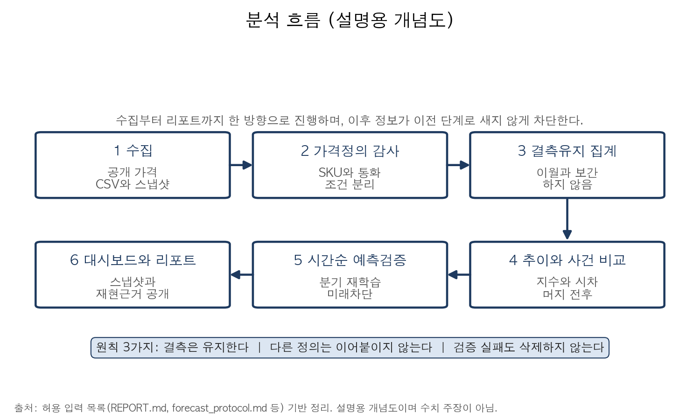

**설명도.** 자료를 확보하는 것과 비교 가능한 가격을 만드는 것은 별도 단계다. 수집→정의·감사→주·월 집계→분석→독립 기간 평가를 거친다. 전체 앱의 원본 JSON은 공개 제외했지만 처리 코드는 보존했다.

## 2. 분석 질문

| 번호 | 질문 | 분석 방법 |
|---|---|---|
| Q1 | 부품 가격의 장기 추세와 현재 견적은 어떻게 다른가? | 기간별 관측률·변화율, 동일 SKU·동급 그룹 비교 |
| Q2 | 부품 가격과 관련 기업 주가는 함께 또는 시차를 두고 움직이는가? | 수준·주별 변화율 상관, ±8주 시차·다중 비교 보정 |
| Q3 | 채굴 붐과 머지 전후에 GPU 가격은 어떻게 변했는가? | 실제 조사 간 변화, 월간 전후 비교, ETH 수익 대용 |
| Q4 | 희소·이상 견적과 성능 조건을 고려하면 비교 결과가 달라지는가? | 배송 포함 복수 견적, 같은 칩·소켓·용량 비교, 민감도 |
| Q5 | 3개월 후 상승·보합·하락 확률을 구매 추천에 쓸 수 있는가? | 시간순 검증, 단순 기준 대비 Brier·MAE·확률 보정 |

## 3. 데이터 설명

### 3.1 연구 전체와 공개판의 범위

| 자료 | 기간·실제 표본 | 가격·단위·기준 | 공개 상태 |
|---|---|---|---|
| 해외 CPU·SSD | 2020\~2022년 156주 중 CPU 148·SSD 135주 | 미국 Amazon 특정 SKU 호가, USD | 원본·정제 시계열 제외, 집계·코드 포함 |
| 관련 주가 | 같은 달력 156주, 종목당 변화율 155개 | AMD·Intel·Micron·NVIDIA·삼성전자·SK하이닉스, 현지 통화 수정주가 | Yahoo 원본·시계열 제외, 상관 통계 포함 |
| 최근 CPU·RAM·SSD·GPU | 2023–2026년 199주 달력, 해외 14개 리스팅. 제품별 유효 24–174주 | USD·INR, 신품·리퍼를 구분한 개별 등록 호가 | 원시 시계열 제외, 관측 수·변화율·상관 집계 포함 |
| 최근 주가·ETH 가격 | 7개 시장, 주별 각각 199개·변화율 198개. 일별 2026-10-23까지 | 6종 현지 통화 수정주가와 ETH 종가 | 원본 제외, 집계 포함 |
| GPU 유럽 소매 | 2021\~2022년 3070/3080/3090 조사 33/29/33회 | EUR 호가, 3DCenter | 원문·가격 곡선 제외, 통계 포함 |
| GPU eBay | 각 16개월, 인접 변화율 각 15개 | 월평균 USD, Tom's Hardware | 원문 표·가격 곡선 제외, 전후 변화 통계 포함 |
| ETH 네트워크 | 2020-01-01\~2022-12-31, 일별 1,096·주별 156개 | Coin Metrics Community, USD·TH/s·ETH | **원본·정제·분석·그래프 포함, CC BY-NC 4.0** |
| 국내 가격·성능 | 2026-10-23 견적·성능 21개 SKU와 월간 이력, 10-25 최초 8개 단면 재조회 | KRW, 동일 포장·용량·배송 기준 분리 | 견적·점수 표 제외, 방법·코드 포함 |
| 예측 평가 | 국내 21+해외 14=35계열, 최종 평가 394행 | 월간 3개월 / 주간 13\~14주 | 계열별 오차·표본 집계 포함, 개별 예측·정답 제외 |

**100점 요건:** 공개판에 실제 포함한 ETH 일별 1,096점으로 충족한다. CPU·GPU의 확보 표본 수는 원래 분석 근거를 설명한 것이며, 공개 저장소에 그 원가격이 들어 있다는 뜻이 아니다. HTTP 응답 성공이나 차트 접근 가능성을 재배포 허가로 해석하지 않았다.

### 3.2 공개 ETH 스키마와 결측

| 구분 | 핵심 컬럼·의미 | 유효 수 |
|---|---|---:|
| 일별 가격 | `date`, `price_usd` | 1,096 |
| 네트워크 입력 | `hashrate_ths`, `fee_tot_ntv`, `iss_tot_ntv`, `iss_tot_usd` | 수집 원본과 필드·단위 대조 |
| 고정 연산력 대용 | `rev_usd_per100mh_gross`(A), `iss_usd_per100mh`(B) | 각 988 |
| 상태 | `unobserved`, `is_partial_transition`, `pow_terminated` | 자료 미관측 0일·전환 1일·종료 뒤 107일 |
| 추적 | `source_file`, `source_sha256` | 행별 원본 추적 |

대용의 빈 값 108일은 임의 보간·0원 처리하지 않는다. 2022-09-15 전환일과 이후 PoW 종료가 원인인 ‘해당 없음’이며, 가격 자료 108일이 사라진 것이 아니다. [ETH 산식·편향](docs/eth_mining_data_basis.md) · [실제 일별 CSV](data/processed/2026-10-22/crypto/eth_daily.csv)

## 4. 전처리와 분석 방법

### 4.1 가격 정의와 이상값

호가와 실거래가, 상품가와 배송 포함가, 일반가와 현금·회원가는 구분한다. 국내 PC·모바일 차트의 겹치는 행을 감사하고 조회 창 경계의 불일치는 원인을 단정하거나 평균내지 않는다. 당월은 미완성으로 표시한다. 현재 견적은 배송비가 확인된 일반몰을 중복 제거한 뒤 낮은 3몰 총액의 중앙값을 사용한다. 3몰 미만이면 산정 보류한다.

해외 가격은 출처의 시각·통화를 유지하고, 0·음수·중복·식별자 불일치·명백한 원문 충돌을 별도 기록한다. 양수 급등을 자동 삭제하지 않는다. 희소 재고에 따른 실제 호가일 수 있기 때문이다. 원자료 수정 없이 격리 사유와 SHA-256을 남긴다. [해외 전처리](docs/overseas_preprocessing.md) · [국내 감사](docs/domestic_price_audit.md)

### 4.2 시계열 분석 기법과 선택 이유

| 기법 | 적용·산식 | 선택 이유·한계 |
|---|---|---|
| 이동평균 | 공개 ETH의 30일 단순 이동평균, 날짜 30개 모두 유효할 때 산정 | 일별 노이즈와 완만한 움직임 구분. 미래 예측 곡선이 아님 |
| 주별 변화율 | ETH는 인접 주 대표값의 `P(t)/P(t-1)-1`. 부품·주가 상관은 인접 주 로그 변화율 | 수준의 공통 추세를 줄임. 빈 주를 건너뛰어 1주 변화율로 계산하지 않음 |
| 구간 평균·전후 증감률 | GPU eBay 머지 전 7\~8월과 후 10\~11월 평균 비교, 9월 제외 | 같은 월간 정의로 비교. 각 2개월이므로 인과 추론 불가 |
| 상관·시차 | 같은 주·같은 짝의 Pearson r, ±8주, 블록 기반 불확실성·보정 | 지연 관계 탐색. 최고 r만 골라 예측력이라 주장하지 않음 |
| 시간순 예측 검증 | 과거에 정답까지 알 수 있었던 사례만 분기별 학습 | 미래 누출 차단. 조회 후 수정된 과거 이력의 회고 검증이라는 한계 |

달력은 토요일\~금요일(W-FRI)로 맞춘다. 주가는 마지막 유효 거래일의 수정주가, 해외 부품은 그 주의 마지막 실제 호가를 고른다. 대표 날짜 차이와 유효 관측률을 감사하고 날짜 이동·격리 제외 민감도도 비교한다. 해외 USD·국내 KRW 가격을 연결하지 않고 환율 미조정을 명시한다.

**추세·계절성·노이즈:** 이동평균은 추세를 보기 위한 기술 통계다. 주별 변화율은 단기 변동을 드러내지만 잔차를 독립 잡음으로 보장하지 않는다. 제품 세대·공급 충격·결측이 섞여 계절성을 식별할 근거가 부족하므로 반복적인 계절 효과를 확인했다고 주장하지 않는다.

### 4.3 ETH 수익 대용

A는 `(발행 ETH+총 수수료 ETH) × ETH USD 가격 ÷ 네트워크 해시율`을, B는 발행분만을 고정 **100 MH/s**로 환산한다. TH/s 입력을 MH/s로 변환한다. 실제 카드별 소비전력·풀 수수료·가동률을 반영한 순이익이 아니다. London 뒤 A에는 소각되는 수수료가 포함되고 Beacon 이후에는 스테이킹 발행이 혼입된다. 두 대용을 실제 GPU 수익의 엄밀한 상·하한으로 해석하지 않는다.

## 5. 분석 결과와 시각화

### 5.1 최근 14개 부품·7개 시장의 동향과 동반 변동 (2023–2026)

**그림 R1. 읽는 방법:** 199주 공통 달력(2023-01-06–2026-10-23)의 관측 범위와 같은 주 로그 변화율 Pearson 상관을 한 장에 묶었다. 원가격 곡선이 아니라 자체 집계다. 부품 4종(CPU·SSD·RAM·GPU)의 대표 행은 아래 표에 따로 적었다. 전체 14×7×17=1,666행 탐색표는 [CSV](data/public/recent_correlations.csv)에 공개한다. p값·유의성·예측 신호를 주장하지 않는다.

| 대표 부품 (4종) | 유효 주 / 199 | 주간 마지막 / 실제 호가 | 같은 주 변화율 예 |
|---|---:|---|---|
| CPU Ryzen 9600X (IN) | 82 | 2026-10-23 / 10-23 | AMD -0.131 (n=81) |
| SSD 990 PRO (US) / SN850X (US) | 163 / 174 | 10-09 / 10-07, 10-16 / 10-13 | 삼성전자 +0.151 (143), ETH +0.175 (153) |
| RAM DDR4 Crucial (US) / DDR5 (IN) | 135 / 124 | 10-16 / 10-15, 10-23 / 10-23 | 삼성전자 -0.282 (103), Intel +0.105 (106) |
| GPU RTX 4060 Eagle (US) / RTX 3070 (IN) | 113 / 99 | 10-16 / 10-13, 10-23 / 10-23 | SK하이닉스 -0.207 (94), 3070은 미산출 (77) |

구형 두 SKU도 같은 달력에 있다. Ryzen 3600은 유효 158주(마지막 10-09, 실제 호가일 10-06), 970 EVO Plus는 173주(마지막 10-02, 실제 호가일 09-26)다. 7개 시장은 주별 각 199주·변화율 198개이며 일별은 미국 4종 각 956일, 한국 2종 각 927일, ETH 1,392일로 모두 10-23까지다. 10월 24일(토) 호가는 아직 완료되지 않은 다음 주에 속하므로 10월 23일 주간 분석에 넣지 않았다. 첫 관측 이전과 이후 결측을 구분하고 보간·이월하지 않았다.

대부분의 동시 상관은 작았지만 RTX 3090–ETH는 r=-0.688(n=18)로 컸다. 이 작은 표본의 큰 계수에 유의성·예측력을 부여하지 않는다. 인도 RTX 3070은 변화율의 분산이 0이어서 n=77이어도 r이 미산출이다. 원시값·해외 모형을 국내 현재가에 그대로 이전하지 않는다. [상세 분석](docs/recent_analysis.md) · [최근 분석 JSON](data/public/recent_analysis.json)

최근 13주 실제 변화는 양 끝 주에 실제 관측이 있는 4개 제품만 산출됐다. Ryzen 9600X(IN) +2.85%, Crucial DDR5(IN) +44.68%, Crucial Pro DDR4(IN) -6.02%, IN RTX 3070 0.0%다. 이는 3개월 예측이 아니며, 규격·브랜드·지역이 다른 개별 SKU의 기술 통계이므로 DDR4/DDR5 전체의 상대 가격이나 국내 시장 동향으로 일반화하지 않는다. 날짜 대조: 구형 CPU 마지막 원시 호가 10-06(주말 주 10-09), 구형 SSD 원시 09-26(주말 주 10-02). 나머지 10개는 양 끝 주 중 하나 이상에 실제 관측이 없어 13주 변화를 산출하지 않았다.

### 5.2 공개 ETH 가격: 추세와 단기 변동이 다르다

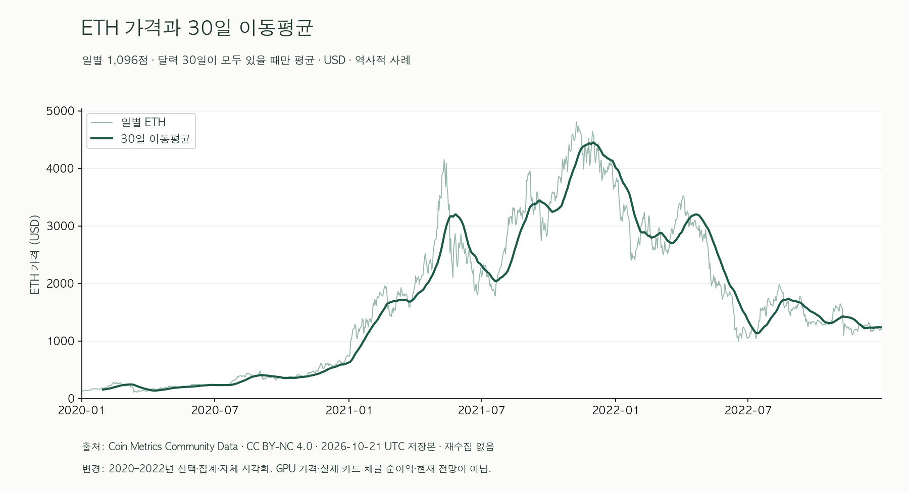

**그림 1. 읽는 방법:** 가로축 날짜, 세로축 USD. 얇은 일별 가격과 굵은 30일 이동평균을 비교한다. 가격 n=1,096, 평균 n=1,067이다. **관찰:** 2021년 상승과 큰 변동, 2022년 하락이 보인다. **해석:** ETH 시장의 과거 구간이며 GPU 가격이나 오늘의 구매 추천 곡선이 아니다.

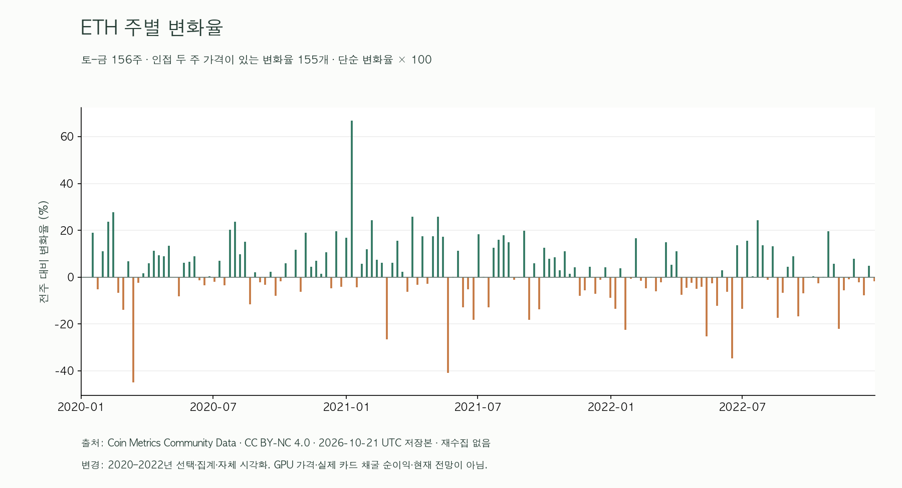

**그림 2. 읽는 방법:** 막대는 % 단위의 단순 주별 변화율이다. 달력 156주 중 첫 주는 전주 기준이 없어 변화율 n=155다. 표준편차의 단위는 %p다.

| 연도 | 일별 n | 연도 첫 관측→마지막 관측 변화 | 주별 변화율 n | 주별 변화율 표본 표준편차 |
|---|---:|---:|---:|---:|
| 2020 | 366 | +468.64% | 50 | 11.91%p |
| 2021 | 365 | +404.43% | 53 | 15.95%p |
| 2022 | 365 | -68.22% | 52 | 11.65%p |

연도 변화는 일별 첫값·끝값 기준이고 달력 1년 수익률의 거래소 확정치가 아니다. 주별 통계는 주 종료 연도로 묶어 경계 주의 전년 대표값을 포함할 수 있다. 2021년의 높은 변동은 상승 추세만으로 매수 시점의 안정성을 판단할 수 없음을 보여준다. [재생성 코드](scripts/build_public_eth_analysis.py) · [연도별 집계](data/public/eth_yearly_summary.csv)

### 5.3 채굴 대용: 종료 뒤 공백은 0원 수익이 아니다

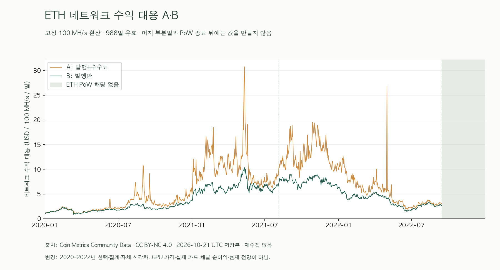

**그림 3. 읽는 방법:** 세로축은 USD/100 MH/s/일, 점선은 사건 시점이다. 일별 유효 대용은 988개다. 머지 전환일 1개와 종료 뒤 107개는 선을 끊었다. **관찰:** 대용 A와 B는 수수료 포함 여부 때문에 차이가 나고 종료 뒤 곡선은 없다. **해석:** 암호화폐 네트워크의 수익 유인이 변한 참고 자료이며 특정 GPU를 운용한 실측 손익은 아니다.

### 5.4 [2020–2022년 사례] 부품 가격·주가: 수준 상관과 변화율 상관은 다르다

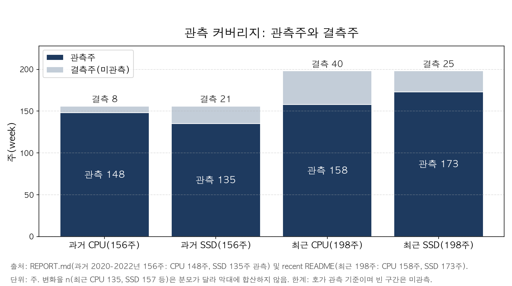

**그림 4.** 10-23 스냅샷 그림으로 과거 156주·최근 198주를 표시한다. 새 199주 분석은 그림 R1에서 확인한다. 달력의 길이와 유효 가격·변화율 수를 구분한다. 2020\~2022년 CPU 148주·SSD 135주가 있어도 변화율 짝은 각각 140·122개로 줄어든다. 최근 2023\~2026년 199주 달력도 전부 가격 관측으로 세지 않는다(14개 부품의 유효 주수는 5.1절과 상세 문서 참조).

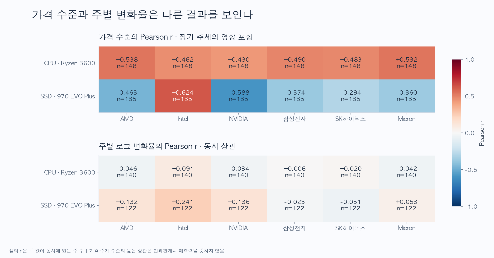

**그림 5.** 색은 원가격이 아니라 자체 계산한 Pearson 상관계수다. CPU–AMD는 수준 r=+0.538에서 주별 변화율 r=-0.046(n=140), SSD–삼성은 -0.374에서 -0.023(n=122)으로 달라진다. 대표 변화율 상관의 블록 기반 95% 구간도 각각 [-0.183, 0.104], [-0.162, 0.131]로 0을 포함한다. 장기 공통 추세가 함께 움직여 보이게 만들 수 있다. [전체 집계](data/analysis/2026-10-22/correlations.csv)

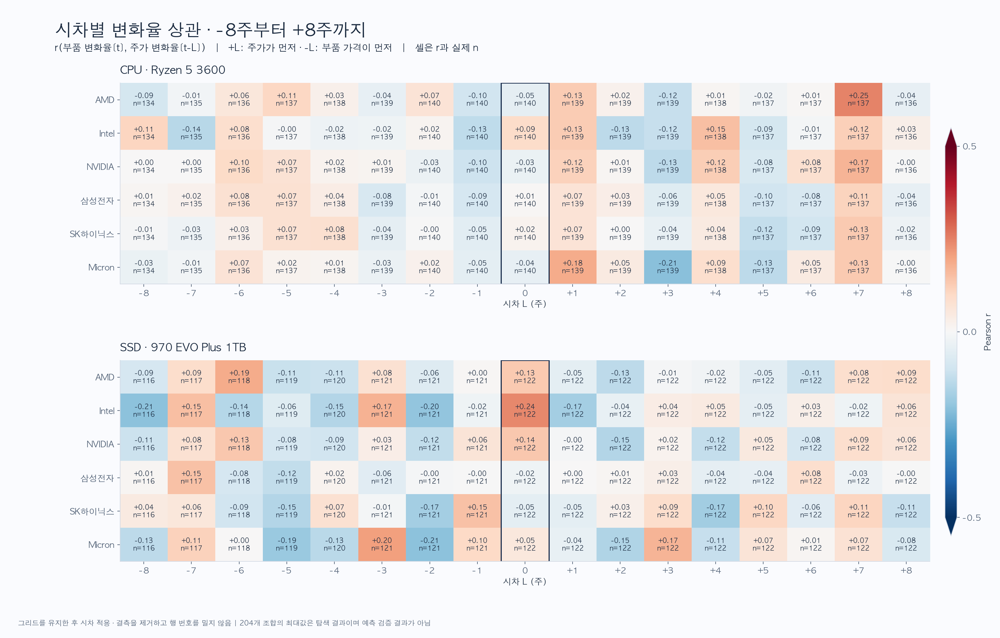

**그림 6.** +L은 주가가 L주 앞서는 방향이다. 2부품×6기업×17시차=204비교를 살펴봤으며 BH·BY 보정 뒤 유의한 결과는 0개였다. 탐색상 큰 계수를 골라도 검증된 선행 신호가 아니다. [모든 시차 결과](data/analysis/2026-10-22/lag_correlations.csv)

그림 5–6의 상관은 2020–2022년 과거 구간이며, 이 문단은 2023–2026년 최근 구간이다. 10-23 스냅샷에서 구형 두 SKU의 처음→마지막 호가는 CPU +19.1%, SSD +187.7%였다. 마지막 관측 주는 CPU 2026-10-09(실제 호가일 10-06), SSD 2026-10-02(실제 호가일 09-26)이며 새 199주 기준에서도 그대로 유지된다. 이는 2020\~2022년 추세를 현재까지 그대로 연장하면 안 된다는 근거다. 다만 구형 두 SKU의 유통 호가를 2026년 전체 시장 상승률로 일반화할 수 없다. 10-23 스냅샷의 같은 주 로그 변화율 동시 상관은 구형 CPU–AMD `r=+0.006(n=135)`, 구형 SSD–삼성전자 `r=+0.054(n=157)`로 약했다. 새 분석은 14개 부품×7개 시장 98쌍으로 확장한다. [최근 표본 요약](data/processed/2026-10-23/recent/README.md)

### 5.5 [2020–2022 채굴 사례] GPU 채굴 붐: 머지 전에 이미 하락했다

**그림 7.** 유럽 소매의 가격 있는 주는 32·29·32주지만 인접 두 주가 있는 변화율은 **1·0·1개**다. ETH가 156주를 채워도 GPU의 빈 주를 메워주지 않는다. 실제 조사 간 변화율과 eBay 월변화율을 별도로 분석했다.

| GPU | 소매 확보 최고 관측→머지 직전 변화 | eBay 머지 전→후 평균 변화 | 전후 표본 |
|---|---:|---:|---:|
| RTX 3070 | -61.3% | -19.5% | 2개월 / 2개월 |
| RTX 3080 10GB | -73.4% | -15.1% | 2개월 / 2개월 |
| RTX 3090 | -65.6% | -16.4% | 2개월 / 2개월 |

소매 최고 관측일은 2021-05-16, 머지 직전 확보일은 2022-09-11이다. 조사 사이의 진짜 최고가는 모른다. eBay는 2022년 7\~8월 대 10\~11월이며 9월은 전환월로 제외했다. 자체 증감률만 제시하고 원가격 표는 공개 제외한다.

조사 간 GPU–ETH 변화율 상관은 0.345/0.538/0.480(n=32/28/32), eBay 월변화율 상관은 0.620/0.597/0.601(각 n=15)이었다. 채굴 대용과의 월변화율은 각 n=11이다. 연도 분할·날짜 정렬에 민감했고, 공급 회복·신제품·재고·환율을 통제하지 못했다. **머지 전부터 하락한 관찰을 머지 하나의 인과 효과로 설명할 수 없다.** 2020년 GPU 숫자 자료는 확보하지 못했고 이미지에서 값을 만들어 넣지 않았다. [GPU 집계 통계](data/analysis/2026-10-22/gpu_mining/correlations.csv)

### 5.6 현재 동급 비교와 미래 구매 시점은 별도 판단이다

국내 8제품을 비교군 포함 21제품으로 늘렸다. 배송 포함 3몰 중앙값은 20개에서 산정됐고, 희소·이상 견적을 제외한 비교 앵커는 19개였다. 특정 5070 Ti 보드의 견적이 다른 네 SKU 중앙값보다 22.6% 높은 사례는 같은 칩의 복수 견적이 필요한 이유를 보여줬다. 견적·벤치마크 표와 이를 복원하는 캡처는 공개 제외했다.

CPU는 PassMark 사용자 제출 집계, GPU는 같은 리뷰의 공통 다종 게임 상대성능을 사용하되 통제 실험·게임 FPS·표본 수의 의미를 구분했다. RAM·SSD는 공통 앱 실측이 없어 용량·사양 비교로 제한했다. 메인보드·전력·중고 처분가 등 총 업그레이드 비용은 반영하지 못했다. 동급 대비 참고가는 성능과 현재 견적의 동률 가격이며 3개월 미래 적정가가 아니다. [구매 비교 산식과 한계](docs/domestic_value_methodology.md)

## 6. 3개월 가격 방향 모형과 검증 결과

### 6.1 미래 누출을 막는 검증

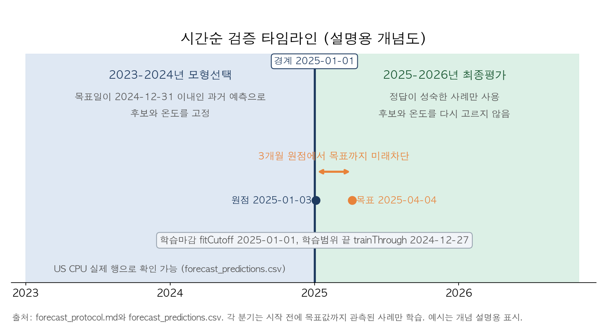

**설명도.** 주간은 달력 3개월 뒤 이상 첫 금요일(13\~14주), 국내 월간은 3개 달 뒤를 목표로 한다. 변화율 -3% 미만=하락, ±3%=보합, +3% 초과=상승이다. 과거 변화율·변동성·가격 위치·관측률·관측 기간을 특징으로 사용했다.

후보는 분류 2종(L2 다항 로지스틱 회귀·제한한 랜덤포레스트)에 시계열 3종(ARIMA(1,1,0)+drift, SARIMA(1,1,0)(1,0,0,s), ETS(A,Ad,N) 로그가격)을 더한 5종이다. 시계열 모형은 같은 SKU의 로그가격만 쓰고 외부 변수를 넣지 않는다. 2023\~2024년 공통 과거 원점에서 모형·확률 온도를 선택하고 2025\~2026년은 최종 평가로 남겼다. 선택 자료가 부족한 계열은 기존 모형을 유지한다. 국내는 동일 월간 정의 21SKU 패널이며 같은 시점의 미래 정답을 함께 차단했다. 분기 학습은 분류 모형은 목표 기간까지 끝난 사례만, 시계열 모형은 분기 시작 전 관측 가격 전부로 적합한다(3개월 목표 성숙 조건 없음). 결측 중앙값도 학습 집합에서만 계산했다. 원가격·목표 결측을 채우거나 미래 주가·ETH를 쓰지 않았다. 2025\~2026년을 본 뒤 후보를 확장한 회고 비교이므로 시험 점수로 모형을 고르지 않았다.

현재 조회한 과거 이력의 회고 평가여서, 당시 실시간으로 저장된 데이터만으로 검증한 결과는 아니다. 공급자의 사후 수정·품절과 결측의 관계는 통제하지 못했다. 국내 최신 월간 목표는 월 버킷 기준으로 오늘부터 3개월과도 다르다. [사전 규약](docs/forecast_protocol.md)

### 6.2 단순 기준 대비 결과

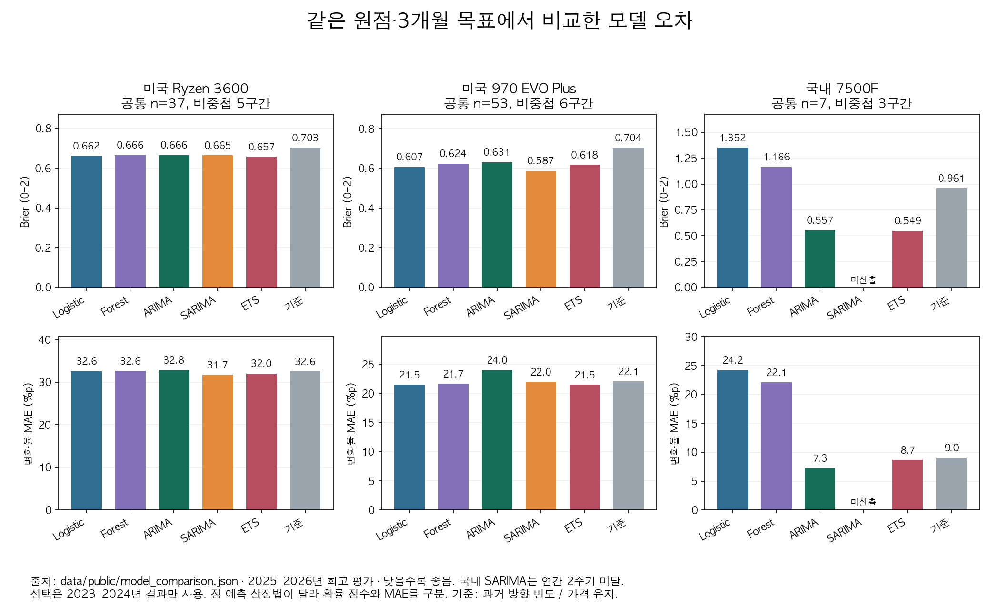

**그림 8.** Brier는 확률 오차, MAE는 변화율 절대오차이며 낮을수록 좋다. 분류 2종에 시계열 3종을 더해 같은 공통 원점에서 비교한다. 기준은 과거 발생 빈도와 가격 유지다. 일부 점수 개선만으로 추천을 허용하지 않았다. 이 그림은 새 5후보 집계에서 그리며, 과거 2후보 수치는 아래 기존-선택 비교표에서 역사 기록으로만 인용한다.

| 대표 계열 | 선택 모형 | 공통 n / 비중첩 | Brier 선택 / 기준 | 변화율 MAE 선택 / 유지 |
|---|---|---:|---:|---:|
| 미국 Ryzen 5 3600 | ARIMA T4.0 | 37 / 5 | 0.6658 / 0.7031 | 32.8 / 32.6%p |
| 미국 970 EVO Plus 1TB | SARIMA T2.0 | 53 / 6 | 0.5875 / 0.7041 | 22.0 / 22.1%p |
| 국내 Ryzen 5 7500F | 로지스틱 T1.0 유지 | 7 / 3 | 1.3522 / 0.9611 | 24.2 / 9.0%p |

| 같은 공통 원점 비교 | 기존 | 선택 | Brier 기존→선택 | MAE 기존→선택 |
|---|---|---|---:|---:|
| Ryzen 5 3600 (n=37) | forest T4.0 | ARIMA T4.0 | 0.6661→0.6658 | 32.6→32.8%p |
| 970 EVO Plus (n=53) | forest T4.0 | SARIMA T2.0 | 0.6240→0.5875 | 21.7→22.0%p |
| 7500F (n=7) | logistic T1.0 | 유지(선택 자료 없음) | 1.3522→1.3522 | 24.2→24.2%p |

CPU는 선택 변경에도 같은 원점 차이가 0.0003에 불과하다. 두 모형 간 paired 우위 검정은 수행하지 않았으며, 기록된 개선 구간(기준 대비)은 0을 포함한다. 7500F의 ARIMA 0.5571·ETS 0.5491은 선택 자료가 없는 계열의 시험 구간 회고 조회이며 교체 근거가 아니다.

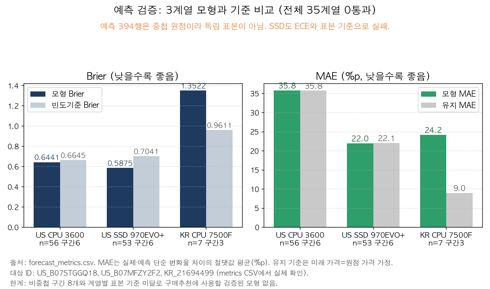

**그림 9. 읽는 방법.** 같은 제품에서 선택 모형과 기준을 비교한다. 분모는 각 모형의 전체 평가 원점(CPU 56·SSD 53·7500F 7)이며, 그림 8의 공통 원점(CPU 37)과 다르다. 선택 FULL Brier는 CPU 0.6441/기준 0.6645, SSD 0.5875/0.7041, 7500F 1.3522/0.9611이다. 공통 비교와 전체 평가는 분모가 다르므로 두 그림의 막대를 직접 비교하지 않는다.

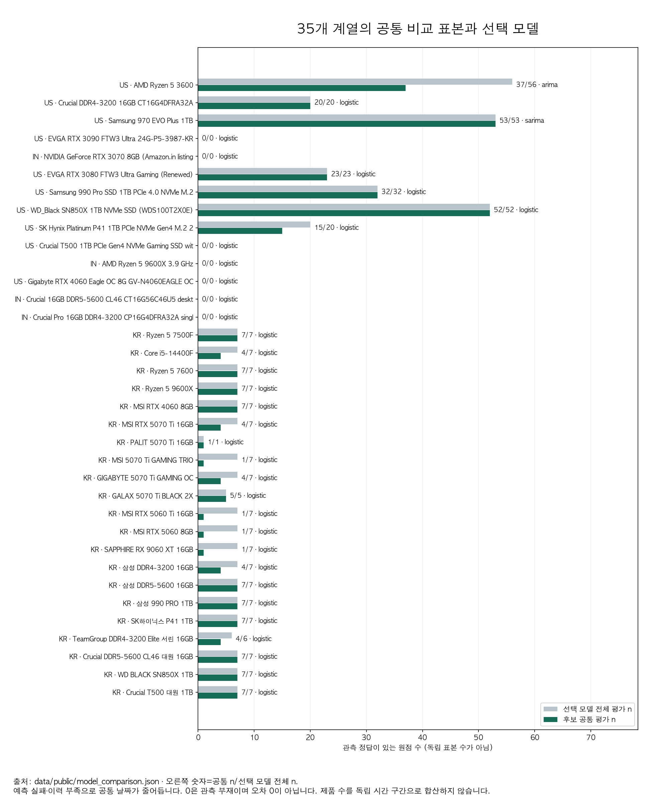

**그림 10. 읽는 방법.** 초록 막대는 후보 비교에 쓴 공통 원점 수, 회색 막대는 선택 모형의 전체 평가 원점 수다. 과거 스냅샷 전체 수는 상세 문서의 표에서 별도로 확인할 수 있다. 공통 332행·선택 FULL 394행 모두 독립 표본이 아니다. [35행 전체 표](docs/model_comparison.md)

총 **35계열·공통 332행·선택 FULL 394행, 추천 사용 기준 통과 0개**다. 목표 기간이 겹치고 같은 시장 충격을 공유하므로 독립 실험이 아니다. 선택 변경 2개는 과거 검증 기준이며 시험 점수로 고른 결과가 아니다. 추천 문턱은 주간 평가 52/월간 12기점, 비중첩 구간 8개, 방향별 10개, 기준 대비 개선의 구간 하한>0, log loss 개선·ECE≤0.1 등으로 사전 고정했다. 구체적 조건은 규약을 따른다. 일부 표본·오차 조건만 충족해도 전체 통과가 아니다.

SSD는 Brier가 0.6240에서 0.5875로 낮아졌지만 방향별 표본 불균형(8·4·41)과 ECE 24.8%p, 비중첩 6개로 게이트를 통과하지 못했다. 국내 7500F는 가격 유지 기준보다 MAE가 컸다. 따라서 상승 확률 숫자를 신뢰 가능한 ‘지금 구매’ 신호로 내놓지 않는다. [모형 비교 상세](docs/model_comparison.md) · [35계열 전체 점수](data/analysis/2026-10-23/forecast/forecast_metrics.csv)

## 7. 인사이트: 관찰·해석·행동 구분

| 관찰한 사실 | 해석·남은 가설 | 의사결정·다음 분석 |
|---|---|---|
| 최근 13주에 DDR5(IN) +44.68%, Crucial Pro DDR4(IN) -6.02%(5.1절) | 같은 RAM 분류에도 규격·리스팅별 움직임이 다름. 국내 세대별 시장 차이를 검증한 것은 아님 | 같은 지역·규격·유통 조건의 비교군을 확보한 뒤 가격 판단 |
| 10-25 재조회에도 구형 CPU·SSD 원출처는 10-06·09-26에서 멈춤(그림 R1) | 수집 성공과 새 관측 확보는 다름. RTX 3090–ETH의 큰 r도 n=18뿐임 | 실제 관측일·결측·짝 수를 확인하고 최신 가격이나 선행 신호로 과장하지 않음 |
| 수준 상관이 커도 주별 변화율 상관은 약함(그림 5) | 공통 추세·생애주기가 수준 관계에 섞일 수 있음 | 주가 상승을 부품 구매 신호로 바로 사용하지 않음 |
| GPU는 머지 직전까지 이미 크게 하락(5.5절) | 채굴 외 공급·세대교체·재고 요인이 함께 작용했을 가능성 | 대조 제품·재고·환율 자료로 기여도 추가 검증 |
| ETH 1,096일도 GPU 결측을 늘려주지 않음(그림 7) | 촘촘한 보조 자료와 목표 관측의 정보량은 다름 | 보간으로 n을 부풀리지 않고 관측 주기별로 분석 |
| 동급 보드에서도 22.6% 견적 차이(5.6절) | 희소 유통·보증·냉각 차이가 섞일 수 있음 | 복수 몰·총액·동일 칩 조건을 확인 |
| ETH 2021년 주별 변동 표준편차 15.95%p(그림 2) | 상승 추세와 단기 가격 안정성은 다른 성질 | 평균 추세와 변화율을 함께 표시 |
| 394행이어도 국내 대표의 비중첩 구간은 3개(6.2절) | 겹치는 목표로 정보가 중복됨 | 새 기간을 축적하고 방향별·보정 성능을 재평가 |

## 8. 결론과 한계

가격 정의·실제 관측·시간 정렬을 먼저 확인해야 부품 비교가 의미를 갖는다. 과거 주가·ETH 상관과 사건 전후 차이는 설명의 출발점이지만 인과 효과나 미래 구매 확률은 아니다. **국내 현재 가격의 3개월 상승·하락을 신뢰할 만큼 예측하는 데에는 이르지 못했다.**

최근 해외 14개 리스팅도 국내 시장 전체를 대표하지 않는다. 신품·리퍼와 USD·INR을 합쳐 하나의 시장 가격으로 해석하지 않았다. 호가는 거래가가 아니며 재고·판매량을 확인하지 못했다. 결측은 무작위가 아닐 수 있고 미완성 월·희소 재고의 영향도 남는다. 채굴 대용은 실제 손익이 아니고 성능 자료의 실험 조건도 다르다. 자동 수집·정기 재학습·알림은 구현하지 않았다.

공개 저장소에는 일부 원본이 없어 전체 부품 모형을 다시 학습할 수 없다. 포함한 ETH 분석·공개 화면은 오프라인 자료만으로 재현하고, 나머지는 집계 통계·방법·전체 코드·제외 파일 목록으로 검토하도록 했다. 원래 전체 연구 자료는 로컬에 보존했다. 후속은 같은 SKU·배송 포함 가격 정의의 장기 자료와 새로운 평가 기간 확보가 우선이다.

## 9. 출처와 이용 주의

| 출처·근거 | 용도·공개 처리 |
|---|---|
| [Coin Metrics Community](https://github.com/coinmetrics/data), [CC BY-NC 4.0](https://creativecommons.org/licenses/by-nc/4.0/) | ETH 원본·가공 자료·ETH 그림 포함. 비영리·출처·라이선스·변경 표시 |
| [PriceHistory](https://pricehistory.app/page/tnc), [다나와](https://www.danawa.com/info/agreement.html) | 부품 호가 이력·견적. 원본과 복원 가능한 파생 시계열 제외 |
| [Yahoo 도움말](https://help.yahoo.com/kb/SLN2310.html) | 주가 원본 재배포 금지 안내. 주가 시계열 제외 |
| [3DCenter](https://www.3dcenter.org/impressum/copyright), [Future](https://futureplc.com/terms-and-conditions-uk/) | GPU 소매·eBay 원문·표 제외, 자체 상관·증감 집계만 분리 |
| [PassMark](https://www.passmark.com/legal/disclaimer.php), [TechPowerUp 원문](https://www.techpowerup.com/review/sapphire-radeon-rx-9060-xt-pulse-oc/33.html) | CPU·GPU 실측 참고. 원문 그림·점수 표 제외 |
| [Ethereum 머지](https://ethereum.org/roadmap/merge/), [EIP-1559](https://eips.ethereum.org/EIPS/eip-1559) | 사건·수수료 구조의 설명 근거 |

권리 확인일과 가격 관측일은 다르다. 10-25에 해외 14개·시장 7개·국내 단면 8개를 재조회했지만 원출처의 최신 관측일은 계열마다 다르다. 새 원본은 비공개로 보존하고 자체 집계만 추가했다. 자체 비가역 집계와 방법 설명의 공개를 원본 재배포 허가로 표현하지 않는다. 상세 근거·직접 열기 제한은 [재배포 검토](docs/data_redistribution.md), 파일별 제외 사유는 [데이터 안내](data/README.md), 코드·문서와 ETH 라이선스 구분은 [RIGHTS](RIGHTS.md)에 기록한다.

## 10. 재현·검증과 산출물

Python 3.12.14와 [고정 의존성](requirements-analysis.txt)을 사용했다. Python 3.10 이상 요건을 충족하며 다른 환경의 전체 재현은 확인하지 않았다. [공개판 실행 순서](docs/reproduction.md)에는 ETH 산식 검사, 공개 파일·SHA·링크 검사, 합성 fixture 기반 화면 규칙 검사와 로컬 서버 실행법을 제공한다.

확장 비교 후 연구 환경에서 Python 191개(10-24 확정)·JavaScript 55개 검사를 통과했고, 10-25 최근 보고서 검사 8개를 더해 전체 199개가 통과했다. 공개판에서는 ETH 6개·모형 비교 36개·최근 보고서 8개 중 연구 복사본 대조 1건을 제외하고 실행한다(공개 유효 49 통과+1 스킵). 공개 화면 JavaScript 20개를 실행할 수 있다. 35계열 예측 모형 비교는 10-23 입력으로 고정했다. 10-25 재수집은 최근 동향 분석을 갱신한 것이며 새 미래 기간의 예측 성과가 아니다. [제출 체크표](docs/submission_checklist.md)에 실행 범위를 구분한다.

전체 분석 코드와 원래 앱 소스는 유지한다. 공개 대시보드는 [ETH 입력](data/public/dashboard.json)과 검증 집계만 읽는다. [공개 파일 manifest](PUBLICATION_MANIFEST.json)에 SHA-256·크기·분류를 남기며, [제외 목록](data/excluded_inventory.csv)에는 값 대신 경로·해시·이유만 기록한다. 과제 PDF 원문은 저작권이 있어 저장소에 포함하지 않았다.

## 11. AI 사용 로그

AI 도구 **Codex**를 조사·분석 코드·해석 초안·화면·문서 작성에 사용했다. 아래는 작업 단위 요약이며 대화 원문 전체의 기록은 아니다.

| 작업 | 사용 이유 | 직접 검증·수정한 판단 |
|---|---|---|
| 출처·확보 가능성 조사 | 장기 가격 데이터의 대안 탐색 | 원문 응답·표·날짜·실제 n 대조, 숫자 없는 이미지는 표본에서 제외 |
| 전처리·통계 코드 | 반복 파싱·감사·집계 | SHA·산식·주 경계·배송비·결측 검사. PC·모바일 차이를 임의로 합치지 않음 |
| 상관·채굴 해석 | 비교 기준·설명 대안 탐색 | 수준/변화율·민감도·다중 비교 확인, 전후 차이를 인과로 표현하지 않음 |
| 구매 예측 | 정적 성능 비교와 추세 규칙의 한계 보완 | 사용자 피드백으로 3개월 목표 고정, 시간순 검증·기준 비교 후 0개 통과 공개 |
| 화면·문서·공개 준비 | 결과를 검토·제출 가능하게 전달 | 실제 화면 조작·캡처, 공개 링크·포함 범위·라이선스 확인, 원본 제외에 따른 재현 제한 명시 |

AI 설명 자체를 증거로 사용하지 않았다. 제출자는 집계 기준·결측 처리·상관과 인과의 차이·예측 실패 기준을 직접 설명할 수 있어야 한다.

## 부록 A. 공개 대시보드 화면과 조작 시나리오

아래 3장은 2026-10-24 저장된 공개 자료로 로컬 실행한 **실제 화면 캡처**다. PDF의 웹 도구 제출 방식 ③(스크린샷과 필터·기간 변경 시나리오)에 대응한다. GitHub 저장소 주소가 웹 앱 배포 주소는 아니다. [실행법](README.md#1-바로-실행하기)

### A-1. 전체 가격 추이

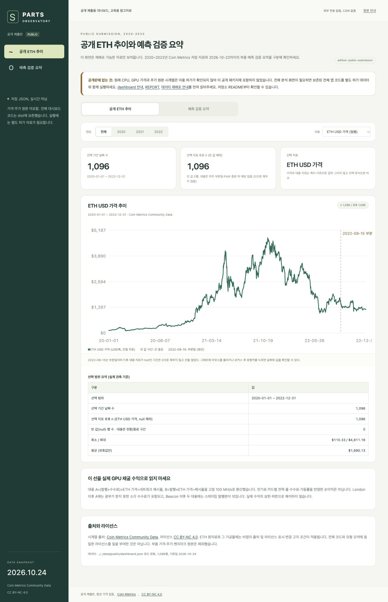

시나리오 1: ‘공개 ETH 추이’에서 ‘전체’와 ‘ETH USD 가격’을 고른다. 기간 날짜 수·유효 n이 각각 1,096이고 기간은 2020-01-01\~2022-12-31인지 확인한다. 그래프에 마우스를 올리거나 포커스 후 방향키를 눌러 날짜별 값을 확인한다.

### A-2. 연도와 대용 지표 변경

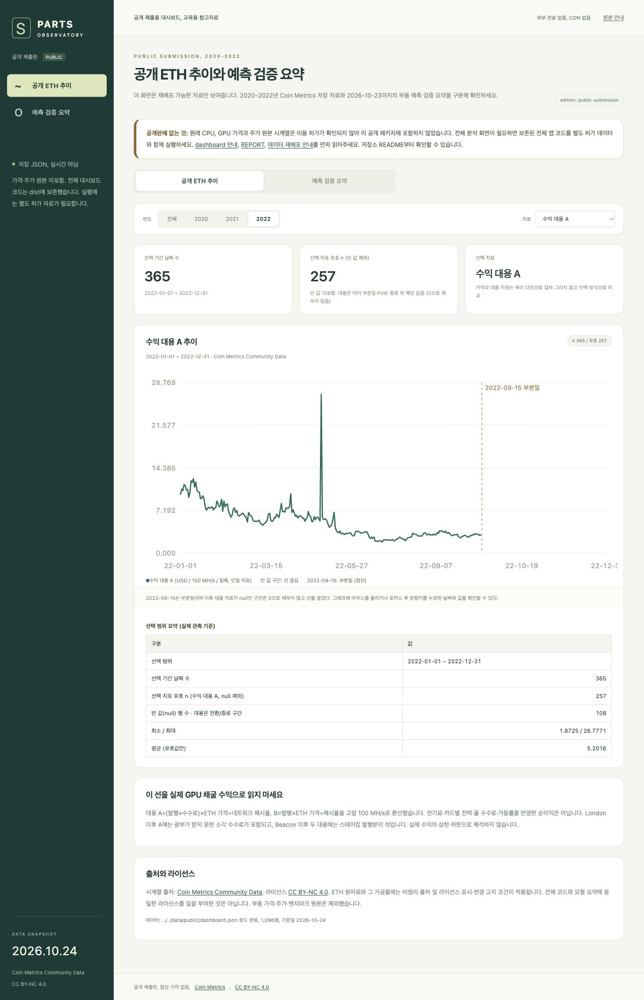

시나리오 2: 연도를 ‘2022’, 지표를 ‘수익 대용 A’로 바꾼다. 날짜는 365개지만 유효 n은 257, 빈 값은 전환일 1개+종료 뒤 107개=108개다. 머지 뒤 공백을 0원 수익이나 미관측으로 오인하지 않는지 확인한다. B로 바꾸면 수수료 제외 대용을 비교할 수 있다.

### A-3. 예측 검증 요약

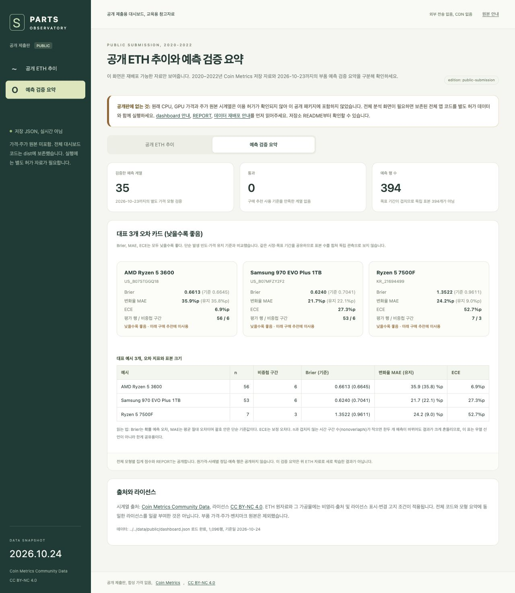

시나리오 3: ‘예측 검증 요약’ 탭에서 35계열·0개 통과·394행을 확인한다. 대표 카드의 n과 비중첩 구간, Brier·MAE·ECE를 함께 읽는다. 이 ETH 자료로 새로 학습한 모형이 아니며, 원가격·개별 확률을 재배포하는 화면도 아니다. 통과 모형이 없으므로 지금 구매·대기 추천을 제공하지 않는 것이 검증 결과와 일치한다.
