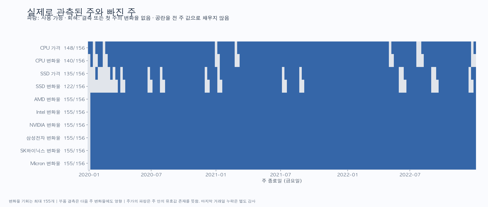

> 공개판 안내: 작성 당시 연구 기록입니다. 원가격·주가·벤치마크 원본과 복원 가능한 파일은 제외했습니다. 현재 공개 범위·실행법은 루트 README와 데이터 이용 안내를 따릅니다.

# 2020~2022년 PC 부품 가격과 기업 주가 분석

분석일: 2026-10-22(KST). 입력 가격은 2026-10-21 스냅샷, 미국 주가도 기존 스냅샷, 한국 주가는 2026-10-22에 확보한 과거 자료다.

**제조사 조합의 같은 주 변화율 상관은 CPU–AMD -0.046(n=140), SSD–삼성전자 -0.023(n=122)으로 작다.** 가격 수준의 상관은 이보다 크지만 주별 동반 변동을 뜻하지 않는다. ±8주에서 선택한 최대 상관도 204개 조합의 다중 비교 보정 후 유의한 결과가 없다. 이는 관계가 없다는 증명이 아니라 이 기간·제품·자료로 안정적인 예측 신호를 확인하지 못했다는 결과다.

## 1. 분석 질문과 범위

1. 부품 가격과 관련 기업 주가는 장기적으로 비슷하게 움직였는가?
2. 같은 주의 가격 변화와 주가 변화가 함께 움직였는가?
3. 주가 또는 부품 가격이 1~8주 먼저 움직이는 관계가 있는가?
4. 결측, 격리 가격, 관측일 차이와 주가 자료의 누락에 얼마나 민감한가?

부품은 Amazon.com의 Ryzen 5 3600(B07STGGQ18)과 970 EVO Plus 1TB(B07MFZY2F2) 두 SKU다. CPU의 제조사 비교는 AMD, 경쟁·업종 비교는 Intel·NVIDIA다. SSD의 제조사 비교는 삼성전자, 메모리 업종 비교는 SK하이닉스·Micron이다. 모든 부품×6종목 12조합도 함께 계산해 특정 기업만 골라 보지 않도록 했다. SSD–Intel 등 다른 조합은 업종 참고이며 해당 SSD 제조사 관계를 뜻하지 않는다.

## 2. 같은 기준으로 맞춘 방법

- 전체 달력은 **2020-01-04~2022-12-30, 토요일~금요일 156주**다. 표의 키는 금요일 `week_end`다. 2020-01-01~03은 전년도에 시작한 부분 주이므로 기존 가격 전처리의 분석 그리드에서 제외했다.
- 부품은 주 안의 마지막 실제 채택 호가다. 전처리에서 격리한 CPU 2건의 제외 상태를 유지한다. 둘 중 2020-05-08의 5.39달러 1건만 분석 기간에 영향을 준다.
- 주가는 거래소 현지 날짜(미국 America/New_York, 한국 Asia/Seoul) 기준 주 안의 마지막 **유효하게 확보한** 거래일의 Yahoo `adjclose`다. 배당·분할 조정 산식은 공급자 정의를 따르며 독립 재계산하지 않았다.
- 결측 주는 비운다. 가격이나 주가를 전 주에서 이월하거나 일별로 보간하지 않았다.
- 변화율은 `ln(P_t/P_(t-1))`이다. 현재 주와 바로 전 달력주가 모두 있어야 한다. 첫 주는 변화율이 없고 그 이후 최대 기회는 155개다. 결측 행을 먼저 삭제한 뒤 변화율이나 시차를 계산하지 않았다.
- 가격 수준은 원본 호가와 수정주가의 Pearson·Spearman 상관으로 비교한다. 추이 그래프는 각 패널의 공통 기준일(CPU 2020-01-10, SSD 2020-01-31)을 100으로 맞춘다. 양의 상수 배율은 상관계수를 바꾸지 않는다.
- 한국 주가는 KRW, 부품은 USD다. 상관계수 자체는 단위 배율에 영향받지 않지만, 원화 주가의 달러 환산 수익률은 계산하지 않아 환율 중립적인 비교는 아니다.
- 부품 원본 시각대는 미확인이다. 같은 주라는 달력 기준은 맞췄지만 정확히 같은 시각의 체결·호가를 맞춘 것은 아니다. 특히 한국 금요일 장 마감과 미국 금요일 장 마감은 시간 순서가 다르다.

가격·주가의 결합 표는 [aligned_weekly.csv — 원본 미포함](../../README.md#excluded), 주가 가격 기준과 원본 감사는 [주가 자료 문서](../../../docs/stock_data_basis.md)에 있다.

## 3. 실제 표본과 결측

| 항목 | CPU | SSD | 각 주식 |
|---|---:|---:|---:|
| 달력 주 수 | 156 | 156 | 156 |
| 가격·수정주가가 있는 주 | 148 | 135 | 156 |
| 가격 수준 결측 주 | 8 | 21 | 0 |
| 변화율 최대 기회 | 155 | 155 | 155 |
| 유효 변화율 | 140 | 122 | 155 |
| 첫 주 외 변화율 손실 | 15 | 33 | 0 |
| 같은 주 상관의 실제 짝 수 | 140 | 122 | 부품별로 달라짐 |
| ±8주 시차의 실제 짝 수 범위 | 134~140 | 116~122 | 시차별로 다시 집계 |

CPU는 주가와 비교 가능한 변화율 기회의 약 9.7%, SSD는 약 21.3%를 잃는다. 부품 결측 하나가 그 주와 다음 주의 변화율을 모두 막을 수 있다. 표의 n은 계산에 들어간 관측 쌍 수이며 독립적인 정보 140·122개를 보장하지 않는다. 같은 가격이 반복된 변화율 0도 CPU 16개, SSD 11개 있으며 삭제하지 않았다. CPU의 가격 있는 주 중 7주, SSD는 29주가 관측일 하루뿐이다.



주가의 156개 주가 채워져 있어도 모든 실제 마지막 거래일이 확보됐다는 뜻은 아니다. 한국 Yahoo 원본은 Naver 원본 742개 실제 세션 대비 유효 일수가 더 적다. 무거래량·전일 값 표시 행과 누락 세션을 제외한 결과, 일부 주는 실제 마지막 세션보다 앞선 유효일을 선택했다.

| 종목 | Yahoo 원본 일수 | 유효 일수 | 거래량 0 표시 행 제외 | 실제 마지막 거래일과 다른 주 | 해당 week_end |
| --- | --- | --- | --- | --- | --- |
| 삼성전자 | 740 | 727 | 13 | 1 | 2022-03-04 |
| SK하이닉스 | 740 | 725 | 15 | 2 | 2022-03-04, 2022-03-11 |

이 주와 다음 주의 변화율을 함께 제외하는 민감도 결과를 아래에 제공한다. 누락일의 수정주가를 Naver 종가로 대체하거나 추정하지 않았다.

## 4. 가격 추이와 같은 주 상관

> **공개 제외 그림:** 공통 기준일 대비 가격과 주가. 원시 시계열·견적을 복원할 수 있어 포함하지 않았습니다. [제외 자료 안내](../../README.md#excluded)

CPU 호가는 첫 유효 주 179.00달러에서 마지막 주 113.99달러로 약 36.3% 하락했다. SSD는 첫 유효 주 198.95달러에서 마지막 주 94.99달러로 약 52.3% 하락했다. 두 SKU의 생애주기와 판매자 변화가 섞인 호가 추이이므로 CPU·SSD 시장 전체의 가격지수로 일반화하지 않는다. 그래프의 빈 구간은 실제 미관측 구간이다.

| 부품 | 기업 | 가격 수준 r | 수준 n | 로그 변화율 r | Spearman | 변화율 n | 개별 95% CI (4주 블록) |
| --- | --- | --- | --- | --- | --- | --- | --- |
| CPU | AMD | +0.538 | 148 | -0.046 | +0.048 | 140 | [-0.183, +0.104] |
| CPU | Intel | +0.462 | 148 | +0.091 | +0.068 | 140 | [-0.076, +0.256] |
| CPU | NVIDIA | +0.430 | 148 | -0.034 | +0.129 | 140 | [-0.175, +0.163] |
| CPU | 삼성전자 | +0.490 | 148 | +0.006 | +0.007 | 140 | [-0.104, +0.136] |
| CPU | SK하이닉스 | +0.483 | 148 | +0.020 | +0.094 | 140 | [-0.131, +0.215] |
| CPU | Micron | +0.532 | 148 | -0.042 | +0.034 | 140 | [-0.188, +0.145] |
| SSD | AMD | -0.463 | 135 | +0.132 | +0.108 | 122 | [-0.037, +0.280] |
| SSD | Intel | +0.624 | 135 | +0.241 | +0.277 | 122 | [+0.058, +0.403] |
| SSD | NVIDIA | -0.588 | 135 | +0.136 | +0.140 | 122 | [+0.031, +0.246] |
| SSD | 삼성전자 | -0.374 | 135 | -0.023 | -0.006 | 122 | [-0.162, +0.131] |
| SSD | SK하이닉스 | -0.294 | 135 | -0.051 | -0.041 | 122 | [-0.194, +0.119] |
| SSD | Micron | -0.360 | 135 | +0.053 | +0.016 | 122 | [-0.098, +0.191] |


CPU–AMD는 수준 r=+0.538이지만 변화율 r=-0.046이고, SSD–삼성전자는 수준 r=-0.374이지만 변화율 r=-0.023이다. 장기 추세의 상관과 단기 변동의 상관을 분리해야 한다. 수준 상관에는 유의성 판정을 붙이지 않았다. 로그 차분이 추세 문제를 완전히 해결하거나 정상성을 보장한다고 가정하지도 않는다. [NIST의 정상성과 차분 설명](https://www.itl.nist.gov/div898/handbook/pmc/section4/pmc442.htm)

교차 참고 조합 SSD–Intel의 같은 주 r=+0.241(n=122)은 12조합 중 가장 크다. 순환 이동 p=0.00645이지만 같은 주 12개 비교의 BH 보정 q=0.0774, 전체 시차까지 포함한 q=0.658로 5% 기준을 통과하지 않는다. SSD–NVIDIA의 개별 부트스트랩 구간도 0을 제외하지만 다중 비교 후 확정 신호로 해석하지 않는다. 제조사 관계나 경제적 원인을 이 상관계수만으로 설명할 수 없다.

> **공개 제외 그림:** 동일 주 로그 변화율 산점도. 원시 시계열·견적을 복원할 수 있어 포함하지 않았습니다. [제외 자료 안내](../../README.md#excluded)

## 5. 시차 상관

정의는 `corr(부품 변화율[t], 주가 변화율[t-L])`다. **L=+7은 주가가 7주 먼저, L=-7은 부품 가격이 7주 먼저인 조합**이다. 시차를 적용한 뒤 두 값이 모두 있는 주만 선택하고 n을 다시 센다. 가격 수준의 시차는 추세 오해를 키울 수 있어 주된 시차 분석에는 로그 변화율만 사용했다.


아래는 각 조합에서 17개 시차 중 절댓값이 최대인 값이다. 최대값을 사후에 골랐으므로 검증된 최적 시차가 아니다. r의 부호는 함께 상승·하락하는지의 방향이고 L의 부호는 어떤 시계열을 먼저 놓았는지를 뜻한다.

| 부품 | 기업 | 최대 절댓값 시차 L | r | 실제 n | 순환 이동 p | 204개 BH 보정 q |
| --- | --- | --- | --- | --- | --- | --- |
| CPU | AMD | +7주 | +0.249 | 137 | 0.0129 | 0.658 |
| CPU | Intel | +4주 | +0.150 | 138 | 0.0710 | 0.709 |
| CPU | NVIDIA | +7주 | +0.169 | 137 | 0.0516 | 0.709 |
| CPU | 삼성전자 | +7주 | +0.112 | 137 | 0.1742 | 0.709 |
| CPU | SK하이닉스 | +7주 | +0.129 | 137 | 0.1484 | 0.709 |
| CPU | Micron | +3주 | -0.208 | 139 | 0.0065 | 0.658 |
| SSD | AMD | -6주 | +0.187 | 118 | 0.0258 | 0.709 |
| SSD | Intel | +0주 | +0.241 | 122 | 0.0065 | 0.658 |
| SSD | NVIDIA | +2주 | -0.148 | 122 | 0.0516 | 0.709 |
| SSD | 삼성전자 | -7주 | +0.148 | 117 | 0.0645 | 0.709 |
| SSD | SK하이닉스 | +4주 | -0.173 | 122 | 0.0645 | 0.709 |
| SSD | Micron | -2주 | -0.207 | 121 | 0.0129 | 0.658 |

CPU–AMD의 +7주 r=+0.249(n=137), SSD–Micron의 -2주 r=-0.207(n=121) 같은 값이 보이지만, 전체 204개 조합에서 BH·BY 보정 후 q<0.05인 값은 각각 0개·0개다. 이 결과를 업그레이드 시점이나 주가 예측 규칙으로 바로 사용하지 않는다.

## 6. 불확실성 계산

Pearson은 선형 동반 변동, Spearman은 순위에 따른 동반 변동을 본다. 계산식은 [NumPy 공식 문서](https://numpy.org/doc/stable/reference/generated/numpy.corrcoef.html)와 대조했다.

같은 주 r의 개별 95% 구간은 **달력주를 4주씩 묶는 paired circular block bootstrap, 3,000회, seed=20261022**로 계산했다. 두 계열과 결측 표시를 함께 재표집해 결측을 압축하지 않았고, 8주 블록 구간도 CSV에 제공한다. 이는 근사적인 개별 구간이며 12기업조합·204시차 전체에 대한 동시 신뢰구간이 아니다. 블록 내 의존성은 유지하지만 표본 전체가 대략 안정적이라는 가정은 남는다. 블록 방식 설명은 [arch 공식 문서](https://arch.readthedocs.io/en/latest/bootstrap/timeseries-bootstraps.html)에 있다. 해당 패키지를 설치하거나 호출하지는 않고 NumPy로 구현했다.

일반적인 독립·정규 표본 Pearson 검정 p값은 시계열에 그대로 적용하지 않았다. 변화율 155주 중 주가 배열을 1~154주 순환 이동해 얻은 상관을 귀무 비교로 사용하고, `(1 + 원래 |r| 이상인 이동 수)/(1 + 유효 이동 수)`를 탐색적 p값으로 기록했다. 시계열 내부 순서와 부품 결측 위치는 유지하되 원래 동시·시차 대응을 끊는 방식이다. 양끝을 연결하는 인공성, 시기별 변동성 변화와 이동 후 결측 조합 차이라는 한계가 있다. 최소 p가 1/155≈0.00645여서 검정력도 제한된다. 이 검정만으로 정상성이나 인과관계를 확인하지 않는다.

같은 주 12개 비교와 전체 시차 204개 비교를 별도 묶음으로 BH 보정했다. 시차 간 의존성을 더 보수적으로 다루는 BY 값도 제공했다. 보정 방식은 [statsmodels 공식 문서](https://www.statsmodels.org/stable/generated/statsmodels.stats.multitest.multipletests.html)에 맞춰 NumPy로 계산했다. 가장 큰 시차만 남겨 검정하지 않았다.

## 7. 민감도와 연도별 변화

조건의 뜻은 다음과 같다.

- `baseline`: 앞서 검증한 기본 가격과 주가.
- `no_quarantine`: 5.39달러를 포함한 격리 전 주 마지막 원본값으로 재계산. 2023년 1.47달러는 분석 기간 밖이다.
- `quotes_within_1d_of_friday`: 현재·전 주의 부품 선택 관측이 각각 금요일에서 0~1일 전일 때만 비교.
- `at_least_3_quote_days`: 현재·전 주 모두 부품 관측일이 3일 이상인 경우만 비교.
- `source_date_shift_-1d/+1d`: 부품 기록일을 하루 앞·뒤로 옮겨 주별 자료를 다시 만든 진단. 정확한 시각대 변환으로 확정한 것이 아니다.
- `exclude_stock_last_session_mismatch_and_next_week`: 한국 주가에서 실제 마지막 거래일보다 앞선 날짜를 선택한 주와 바로 다음 주를 함께 제외.

| 부품 | 기업 | 조건 | r | n |
| --- | --- | --- | --- | --- |
| CPU | AMD | baseline | -0.046 | 140 |
| CPU | AMD | no_quarantine | -0.053 | 140 |
| CPU | AMD | quotes_within_1d_of_friday | -0.108 | 105 |
| CPU | AMD | at_least_3_quote_days | -0.065 | 112 |
| CPU | AMD | source_date_shift_-1d | +0.050 | 142 |
| CPU | AMD | source_date_shift_+1d | -0.040 | 141 |
| CPU | Intel | baseline | +0.091 | 140 |
| CPU | Intel | no_quarantine | -0.041 | 140 |
| CPU | Intel | quotes_within_1d_of_friday | +0.102 | 105 |
| CPU | Intel | at_least_3_quote_days | +0.092 | 112 |
| CPU | Intel | source_date_shift_-1d | +0.032 | 142 |
| CPU | Intel | source_date_shift_+1d | -0.000 | 141 |
| SSD | Intel | baseline | +0.241 | 122 |
| SSD | Intel | no_quarantine | +0.241 | 122 |
| SSD | Intel | quotes_within_1d_of_friday | +0.398 | 55 |
| SSD | Intel | at_least_3_quote_days | +0.415 | 34 |
| SSD | Intel | source_date_shift_-1d | +0.197 | 120 |
| SSD | Intel | source_date_shift_+1d | +0.282 | 126 |
| SSD | 삼성전자 | baseline | -0.023 | 122 |
| SSD | 삼성전자 | no_quarantine | -0.023 | 122 |
| SSD | 삼성전자 | quotes_within_1d_of_friday | -0.003 | 55 |
| SSD | 삼성전자 | at_least_3_quote_days | +0.204 | 34 |
| SSD | 삼성전자 | source_date_shift_-1d | +0.015 | 120 |
| SSD | 삼성전자 | source_date_shift_+1d | +0.013 | 126 |
| SSD | 삼성전자 | exclude_stock_last_session_mismatch_and_next_week | -0.024 | 120 |

주별 관측일 3일 조건은 CPU–AMD n=112, SSD–삼성전자 n=34까지 줄인다. SSD–삼성전자는 이 조건에서 r=+0.204로 바뀌므로 기본 결과의 작은 음수를 안정적인 방향성으로 읽을 수 없다. SSD–Intel도 n=34에서 r=+0.415로 커지지만 더 적고 선택된 표본의 결과다. CPU–Intel은 격리한 5.39달러를 다시 포함하면 r=+0.091에서 -0.041로 방향이 바뀐다. 날짜를 하루 이동했을 때도 표본 수와 계수가 달라진다. 결측이 가격 급변·품절 등과 무관하게 생겼다는 보장이 없으므로 단순한 표본 수 감소 이상의 편향이 가능하다.

연도별 결과는 각 주 종료 연도에 배정했다. 전체 구간에서 계산한 변화율을 나눴으므로 연초 변화율은 전년도 마지막 주를 분모로 포함할 수 있다.

| 부품 | 기업 | 2020 r (n) | 2021 r (n) | 2022 r (n) |
| --- | --- | --- | --- | --- |
| CPU | AMD | +0.051 (46) | -0.183 (49) | -0.046 (45) |
| CPU | Intel | +0.365 (46) | -0.107 (49) | +0.083 (45) |
| SSD | 삼성전자 | -0.037 (31) | -0.003 (47) | -0.013 (44) |
| SSD | Intel | -0.026 (31) | +0.370 (47) | +0.366 (44) |

CPU–Intel은 2020년 양수, 2021년 음수로 방향도 달라진다. 일정한 관계를 전 기간에 가정하기 어렵다. 연도·필터·시차를 추가로 탐색한 결과에는 별도의 확정적 유의성 주장을 붙이지 않았다.

## 8. 결과의 사용 범위

확인한 것은 두 해외 SKU의 호가 기록과 여섯 기업 주가 사이의 표본 내 관계다. 현재 분석으로는 제조사 주가를 이용해 PC 부품의 단기 구매 시점을 정하는 근거가 약하다. 다음 과제 단계에서는 제품군·세대별 표본을 늘리고 판매자·재고·환율·성능 정보를 보강하는 편이 유용하다. 채굴 붐의 영향은 GPU 가격·채굴 수익성·공급 사건 자료를 별도로 맞춰 분석해야 한다. 이번 CPU·SSD 상관만으로 채굴 수요가 가격 변동을 일으켰다고 결론 내리지 않는다.

## 9. 파일과 재현

- [결합 주별 데이터 — 원본 미포함](../../README.md#excluded): 2제품×6종목×156주=1,872행. 중복된 제품 가격 행을 별개 관측으로 합산하면 안 됨.
- [수준·변화율 상관](correlations.csv): 12행, Pearson·Spearman·표본 수·4/8주 블록 구간·같은 주와 전체 보정 q.
- [모든 시차](lag_correlations.csv): 204행, 시차별 n과 보정 값.
- [시차별 최대값](lag_peaks_exploratory.csv): 12행, 탐색 요약.
- [민감도](sensitivity.csv), [연도별 상관](correlations_by_year.csv), [가용 표본](coverage.csv).
- [분석 설정·버전·입력 SHA-256 — 원본 미포함](../../README.md#excluded).
- `figures/`: 같은 그래프의 PNG와 확대·편집용 SVG 각 5개.

```bash
python3 -m venv .venv
.venv/bin/python -m pip install -r requirements-analysis.txt
.venv/bin/python scripts/prepare_weekly_stocks.py
.venv/bin/python scripts/analyze_price_stock_correlations.py
.venv/bin/python scripts/plot_price_stock_correlations.py
.venv/bin/python scripts/write_price_stock_report.py
.venv/bin/python -m unittest discover -s tests -v
```

분석 의존성은 Python 3.11 이상이 필요하며 3.12.14에서 검증했다. 원본이 저장되어 있으므로 재현 과정에서 가격·주가를 다시 내려받지 않는다. 표준 전처리 원본·격리 기준은 [해외 전처리 문서](../../../docs/overseas_preprocessing.md)를 따른다. 그림은 Matplotlib을 사용했고 macOS AppleGothic 글꼴을 적용했다. 다른 운영체제에서는 한국어 글꼴 설정이 필요할 수 있다.

AI는 데이터 출처 확인, Python 전처리·분석·그림 코드 작성, 해석 초안에 사용했다. 원본 해시, 행 수와 표본 수 대조, 달력 시차·결측·변화율·보정 수식 테스트 및 생성한 5개 그래프 시각 검토로 결과를 검증했다. 자동 계산 결과와 출처의 정의가 확인되지 않은 설명은 구분해서 기록했다.
