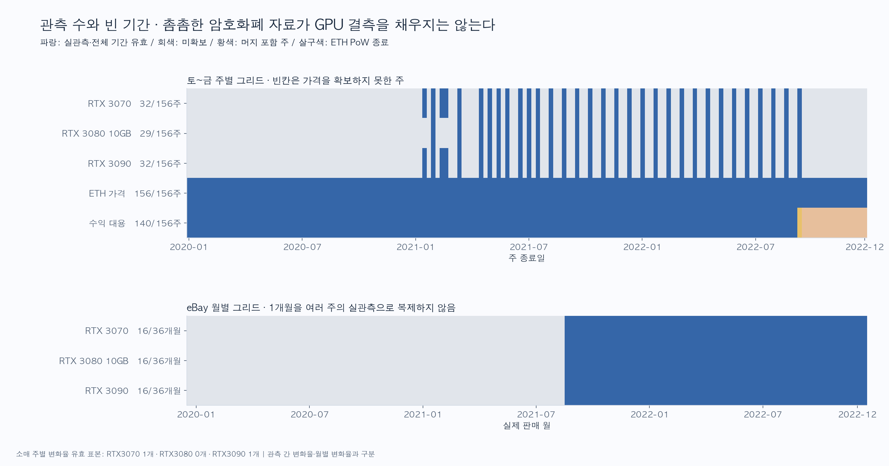

> 공개판 안내: 작성 당시 연구 기록입니다. 원가격·주가·벤치마크 원본과 복원 가능한 파일은 제외했습니다. 현재 공개 범위·실행법은 루트 README와 데이터 이용 안내를 따릅니다.

# GPU 가격·이더리움·채굴 붐 분석 (2020~2022 요청 범위)

분석일: 2026-10-22. 저장한 원문 수치와 공개 API를 사용한 **기술 통계 분석**이다.

**확보된 소매 관측 최고가(2021-05-16)에서 머지 직전(2022-09-11)까지 세 GPU 가격은 61~73% 하락했다. eBay 월별 판매가격은 2022년 7~8월보다 10~11월에 15~19% 낮았다.** 이미 머지 전에 큰 폭으로 하락했고, 이 차이가 머지만의 효과라는 인과관계는 식별하지 못했다.

2020~2022년 3년 전체를 동일한 밀도로 관측한 GPU 자료는 확보하지 못했다. **선정한 세 GPU의 2020년 원문 수치 관측은 0개**다. 실제 카드별 채굴 순이익도 미확보이며, 네트워크 발행량·수수료·해시레이트로 만든 편향이 있는 대용 지표를 별도로 제시한다. 빈 기간을 보간해 일별·주별 표본으로 만들지 않았다.

## 1. 출처와 실제 표본 수

- **3DCenter:** 독일·오스트리아 소매점에서 재고가 있는 제품의 최저 호가. 2021년 과거 표 20시점과 2022년 13시점, 총 33개 조사일을 원문에서 추출했다. MSRP·권장가는 제외했다. RTX 3080은 **10GB**만 쓰고 12GB·Ti를 제외했다. 2021년 범위값은 하단값을 사용했다. 판매량 가중 평균이나 거래 체결가는 아니다. [2021년 원문](https://www.3dcenter.org/news/hardware-und-nachrichten-links-des-1112-dezember-2021), [2022년 마지막 원문](https://www.3dcenter.org/news/news-des-1011-september-2022).
- **Tom’s Hardware/eBay:** 판매완료 목록의 월별 평균가격과 원문 QTY Sold. 2021-09~2022-12의 **16개월**, 세 GPU 총 **48개 월별 가격**을 원문 16페이지에서 확인했다. 신품·중고·판매자·세부 모델 구성이 소매 자료와 다르므로 USD와 EUR를 연결하지 않았다. [자료와 수집 설명](https://www.tomshardware.com/news/gpus-historical-ebay-pricing).
- **Coin Metrics:** ETH 가격 2020-01-01~2022-12-31 **1,096일**. 해시레이트와 대용 지표 계산 가능 기간은 2022-09-14까지 **988일**. 9월 15일은 전환 부분일 1일, 그 뒤 107일은 ETH PoW 종료에 따른 해당 없음이다. 일반적인 자료 누락과 구분한다. [공개 데이터 설명](https://gitbook-docs.coinmetrics.io/packages/coin-metrics-community-data).

주별 그리드는 앞선 CPU·SSD 분석과 동일한 토~금, 종료일 2020-01-10~2022-12-30의 **156주**다. 연초·연말 경계 4일은 주별 표에서 제외하고 일별 원본에는 남겼다.

| 제품 | 유효 소매 조사일 | 가격 있는 주 /156 | 미관측 주 | 인접 주 변화율 | 실제 관측 간 변화율 | eBay 유효 월 / 월변화율 |
| --- | --- | --- | --- | --- | --- | --- |
| RTX 3070 | 33 | 32 | 124 | 1 | 32 | 16 / 15 |
| RTX 3080 10GB | 29 | 29 | 127 | 0 | 28 | 16 / 15 |
| RTX 3090 | 33 | 32 | 124 | 1 | 32 | 16 / 15 |

3070·3090의 33개 조사일이 32개 주인 이유는 2021-01-17과 01-22가 같은 토~금 주에 있기 때문이다. 주별 표에는 마지막 유효 가격만 남겼다. 3080은 원문 조사일 중 가격 공란이 4개다. 소매 실제 관측 간격의 중앙값은 21일, 최장 간격은 3070·3090 32일, 3080 44일이다.

**주별 변화율 표본은 1·0·1개여서 주별 상관·회귀를 계산하지 않았다.** ETH 1,096일이나 eBay 판매 목록 수를 GPU 주별 시계열 표본 수로 세지 않는다. eBay의 36개월 그리드 중 제품별 20개월은 미확보다.



## 2. 같은 기준으로 맞춘 방법

1. 소매 GPU 관측일 D에 **D-7~D-1의 ETH 일별 값 7개 평균**을 붙였다. 모두 있어야 유효하다. ETH 일별 가격은 원문 날짜의 UTC 일 마감 값이다. 독일 소매 호가의 장중 시각은 일정하지 않아 엄밀한 장중 선행성 검증은 아니다. [PriceUSD 정의](https://gitbook-docs.coinmetrics.io/network-data/network-data-overview/market/price).
2. 실제 연속 유효 조사일끼리 `ln(현재 / 이전)`을 계산했다. 간격 일수를 함께 보존하며 **관측 간 변화율**이라고 부른다. 결측을 건너 44일간 바뀐 값을 1주 변화율로 취급하지 않는다.
3. eBay는 **실제 판매월**에 맞춘다. 같은 달 ETH 일별 가격의 산술 평균을 결합한다. 채굴 대용은 해당 월의 모든 날짜가 유효할 때만 월평균을 만든다. 그러므로 2022-09의 채굴 대용은 빈칸이며 ETH 가격·GPU 가격은 유효하다.
4. 2022-09 eBay 가격은 정상적인 한 달 집계다. 머지 전후가 섞인 월이라는 표시만 한다. 월별 GPU 변화율은 9월이 낀 구간도 유지해 제품별 15개다. 전후 비교의 전·후 구간에서만 9월을 뺀다.
5. 월간 가격을 주별로 복제하지 않고, 결측 가격·종료 후 ETH 채굴 지표를 0으로 채우지 않는다. 통화·시장·최저 호가/평균 판매가격은 각각 유지했다. EUR 소매가격과 USD ETH·수익 대용을 비교할 때 환율 영향을 제거하지 못했다. USD eBay 분석은 이 통화 차이는 없지만 시장·집계 기준이 다르다.

소매 수준 상관은 제품별 n=33/29/33, 관측 간 변화율 상관은 n=32/28/32다. eBay–ETH 수준 상관은 n=16, 변화율은 n=15다. eBay–채굴 대용은 2021-09~2022-08만 겹쳐 수준 n=12, 변화율 n=11이다.

## 3. 채굴 수익성 자료의 산식과 편향

실제 광부 매출 RevUSD, 카드별 해시 성능·소비전력·전기료·가동률을 갖춘 실측 순이익은 확보하지 못했다. 공개 지표로 다음 두 **네트워크 수익 대용**을 계산했다.

```text
A = (일별 신규 발행 ETH + 일별 총수수료 ETH) × ETH 가격
    ÷ (네트워크 해시레이트 TH/s × 1,000,000) × 100
B = 일별 신규 발행 ETH × ETH 가격
    ÷ (네트워크 해시레이트 TH/s × 1,000,000) × 100
단위: 고정 100MH/s당 USD/일
```

ETH HashRate의 단위는 TH/s이며, 난이도와 블록 간격에서 추정한 네트워크 지표다. 따라서 TH/s를 MH/s로 바꿀 때 10⁶을 곱했다. [해시레이트 정의](https://gitbook-docs.coinmetrics.io/network-data/network-data-overview/mining/hash-rate).

**두 지표 모두 실제 채굴 순이익이나 광부 매출의 확정적인 상·하한이 아니다.**

- **Beacon 보상 혼입:** Coin Metrics 공식 정의상 2020-12-01 Beacon 출범 이후 머지 이전의 ETH 발행량에는 채굴 보상과 스테이킹 보상이 함께 들어 있다. 별도 합의 레이어 분리 시계열 요청은 HTTP 403으로 확보하지 못했다. 두 지표 모두 이 혼입을 보정하지 못했다. [발행량 정의](https://gitbook-docs.coinmetrics.io/network-data/network-data-overview/supply/supply-issuance).
- **London 이후 소각분 과대포함:** 2021-08-05부터 기본 수수료가 소각되고 팁이 광부에게 지급된다. 총수수료를 모두 더한 A에는 소각분이 포함돼 광부가 받은 수수료를 과대평가한다. B는 모든 수수료를 빼므로 팁도 빠지며, MEV는 두 지표 모두 직접 측정하지 못한다. [공식 연혁](https://ethereum.org/ethereum-forks/), [EIP-1559](https://eips.ethereum.org/EIPS/eip-1559).
- **고정 성능 가정:** 실제 RTX별 LHR 여부·메모리 설정·다운타임·풀 수수료가 없다. 참고 전기료는 200W×24시간=4.8kWh/일, 0.10/0.20 USD/kWh에서 0.48/0.96 USD/일을 빼는 시나리오뿐이다. CSV의 `net_*`도 실측 순이익이 아니다.
- **머지 이후:** [2022-09-15 이더리움 머지](https://ethereum.org/roadmap/merge/)로 ETH PoW가 종료됐다. 이후 ETH 지표는 해당 없음으로 둔다. 다른 코인으로 전환한 GPU 채굴 수익은 이번 범위에 없다. GPU 채굴 전체의 수익이 0이 됐다고 해석하지 않는다.

일별 파일의 `london_burn_overincluded`, `beacon_issuance_included`, `is_partial_transition`, `pow_terminated`, `unobserved`로 원인을 구분했다. 주별 채굴 대용은 전체 7일이 유효한 140주, 머지 포함 혼합 1주(유효 5일), 종료 15주다. 혼합 주 평균은 5일 평균이라고 표시하며 완전한 7일 표본으로 세지 않는다.

> **공개 제외 그림:** GPU와 ETH·네트워크 지표 시계열. 원시 시계열·견적을 복원할 수 있어 포함하지 않았습니다. [제외 자료 안내](../../../README.md#excluded)

## 4. 채굴 붐과 가격 변화: 관측한 사실

### 2021년 급등과 머지 이전 하락

세 제품의 **확보된 소매 관측 중 최고가**는 모두 2021-05-16이었다. 관측 사이에 더 높은 가격이 있었는지는 알 수 없다. 첫 관측도 이미 채굴 붐이 진행된 시점이어서 붐 이전 정상가격의 기준이 아니다.

원가격이 포함된 표는 공개 제외했다. [공개 보고서의 자체 전후 증감률](../../../../REPORT.md#54-gpu-채굴-붐-머지-전에-이미-하락했다)을 참고한다.

같은 7일 창으로 맞춘 ETH 가격은 2021-05-16 관측에 대응하는 평균 3,921.16 USD에서 2022-09-11 대응 평균 1,645.79 USD로 낮아졌다. 네트워크 대용 A는 22.18→3.05, B는 9.75→2.71 USD/일/100MH/s였다. 다만 두 시점 사이 London으로 A의 수수료 해석이 바뀌므로 이를 실제 채굴 이익 감소율로 제시하지 않는다.

2021년 여름 하락 뒤 늦가을 재상승도 보여, 전체 기간을 단일 상승·하락 구간으로 설명하기 어렵다. [NVIDIA의 2021-05-18 LHR 발표](https://blogs.nvidia.cn/blog/lhr/)처럼 특정 제품의 채굴 성능과 판매 구성이 달라지는 요인도 있었다. 현재 표는 LHR별 제품을 분리하지 못하므로 가격 변화를 채굴 수요 하나에만 귀속할 수 없다.

### 머지 전후: eBay 2개월 대 2개월

전은 2022년 7·8월 월별 평균의 단순 평균, 후는 10·11월 월별 평균의 단순 평균이다. 전후의 달마다 같은 가중치를 부여한다. 판매량으로 가중한 전체 거래 평균은 아니다. 9월은 전환일이 포함돼 제외했다.

원가격이 포함된 표는 공개 제외했다. [공개 보고서의 자체 전후 증감률](../../../../REPORT.md#54-gpu-채굴-붐-머지-전에-이미-하락했다)을 참고한다.

후 구간의 원문 판매 수량 집계도 증가했다. 하지만 개별 거래 원본·판매자의 채굴 사용 이력·재등록 여부가 없어, 증가분을 ‘채굴 카드 처분 물량’으로 확정할 수 없다. 판매량 수천 건은 월별 상관 분석의 표본 수가 아니다.

2022년 1분기와 4분기의 비교에서는 약 59~64% 하락했다(`price_changes.csv`). 구간을 바꾸면 하락 폭이 달라진다. 위 2개월 비교는 머지 시점 주변의 기술 통계이며, 표본이 각 2개월뿐이고 공급 회복·세대교체·수요·상품 상태 구성을 통제하지 못했다. **머지의 독립적인 가격 하락 효과나 통계적 유의성으로 보고하지 않는다.**

> **공개 제외 그림:** 머지 전후 월별 가격. 원시 시계열·견적을 복원할 수 있어 포함하지 않았습니다. [제외 자료 안내](../../../README.md#excluded)

## 5. ETH·네트워크 대용과 GPU 가격의 상관

아래는 피어슨 상관계수다. 양수는 같은 방향으로 움직인 경향을 뜻하며, 원인·안정적인 예측력·지금의 적정가를 뜻하지 않는다. 수준 상관은 공통 장기 추세와 자기상관에 민감하므로 변화율을 별도로 제시했다. 작은 의존 표본에 독립 관측을 가정한 p값이나 ‘유의하다’는 표시는 붙이지 않았다.

**소매: 실제 조사일 사이 로그 변화율**

| 제품 | 실제 변화 구간 n | GPU–ETH | GPU–A | GPU–B |
| --- | --- | --- | --- | --- |
| RTX 3070 | 32 | 0.345 | 0.380 | 0.209 |
| RTX 3080 10GB | 28 | 0.538 | 0.540 | 0.361 |
| RTX 3090 | 32 | 0.480 | 0.515 | 0.360 |

소매 가격 수준과 ETH의 상관은 약 0.332~0.680, A와는 0.737~0.832, B와는 0.700~0.809다. 가격 수준의 높은 상관을 실제 가격 변화의 상관과 혼동하면 안 된다. A/B는 편향이 있는 대용 지표이며 서로 독립적인 검증 자료도 아니다.

**eBay: 같은 달 기준. 괄호는 실제 겹치는 표본 수**

| 제품 | 수준 GPU–ETH | 월변화율 GPU–ETH | 월변화율 GPU–A | 월변화율 GPU–B |
| --- | --- | --- | --- | --- |
| RTX 3070 | 0.954 (n=16) | 0.620 (n=15) | 0.637 (n=11) | 0.622 (n=11) |
| RTX 3080 10GB | 0.956 (n=16) | 0.597 (n=15) | 0.534 (n=11) | 0.613 (n=11) |
| RTX 3090 | 0.962 (n=16) | 0.601 (n=15) | 0.576 (n=11) | 0.604 (n=11) |

2021년 후반 고가격에서 2022년 저가격으로 함께 이동한 짧은 구간이라 월별 수준 상관이 특히 높다. 변화율에서는 낮아지고 채굴 대용은 n=11뿐이다. 세 GPU가 같은 시장 충격을 공유하므로 세 제품의 n을 더해 독립 표본으로 취급하지 않는다.

### 안정성 점검

소매 관측 간 변화율을 연도별로 나누고 연도 경계를 넘는 구간을 제외하면 ETH와의 상관은 다음과 같다.

| 제품 | 2021년 | 2022년(머지 전까지) |
| --- | --- | --- |
| RTX 3070 | 0.404 (n=19) | 0.017 (n=12) |
| RTX 3080 10GB | 0.778 (n=15) | -0.328 (n=12) |
| RTX 3090 | 0.686 (n=19) | -0.314 (n=12) |

2022년에는 관계가 약해지거나 부호가 바뀐다. 전체 구간의 양의 상관을 그대로 구매·예측 규칙으로 사용하기 어렵다는 근거다.

GPU 날짜에 붙이는 7일 창을 기본값에서 ±1일 이동하면 다음 범위였다.

| 제품 | GPU–ETH 관측 간 변화율 상관 범위 | 각 정렬 n |
| --- | --- | --- |
| RTX 3070 | 0.305~0.383 | 32 |
| RTX 3080 10GB | 0.495~0.569 | 28 |
| RTX 3090 | 0.441~0.517 | 32 |

이 점검은 **날짜 정렬 민감도**이며 선행·후행 효과를 검증한 시차 상관이 아니다. 관측 간격을 일수로 나눈 변화율, 35일 이하 간격만 남긴 결과, 연도별 A/B, 순위 기반 스피어먼 상관도 `correlations.csv`에 저장했다. 이러한 선택으로 가장 큰 계수를 고르는 방식은 사용하지 않는다.

> **공개 제외 그림:** 실제 관측 시점에 맞춘 상대 변화. 원시 시계열·견적을 복원할 수 있어 포함하지 않았습니다. [제외 자료 안내](../../../README.md#excluded)

## 6. 제외한 자료와 해석 가능한 범위

| 자료·문제 | 처리 | 남는 한계 |
| --- | --- | --- |
| 2020년 선정 GPU 가격, eBay 2021-08 이전 | 원문 수치 미확보로 공란 | 2020년 붐 시작·출시 직후 가격을 직접 비교하지 못함 |
| Tom’s 2020-12~2021-03 페이지 | 이미지 차트만 확인, 숫자 생성하지 않음 | 해당 기간의 정량 표본에 포함하지 않음 |
| 외부 GPU 연구 일별 CSV | 보간 포함·원관측 마스크 미확보로 제외 | 매일 실측한 자료처럼 사용할 수 없음 |
| eBay 2021-10-01~15 부분월 3행 | 별도 파일 보존, 월간 분석 제외 | 10월 전체월 표와 중복 합치지 않음 |
| 3DCenter MSRP 대비 가격지수 | 별도 세 시리즈로 보존, 제품 EUR 호가와 분리 | 통화·환율·제품군 구성 차이를 제품 가격으로 오해하지 않음 |
| RTX 3080 4개 원문 가격 공란 | 공란 유지 | 실제 관측 간 최대 44일 간격 |
| 머지 포함 일·월 | 해당 채굴 대용을 제외, GPU/ETH 가격은 유지 | 급격한 전환 직후의 일별 가격 반응은 식별 불가 |
| 실제 광부 매출·Beacon 분리·소각량·카드 실측 | 미확보 명시 | 채굴 순이익·투자 회수기간은 계산할 수 없음 |

과제에서 가능한 결론은 **2021~2022년 관측된 GPU 고가격·하락 국면, ETH와의 동행 정도, 머지 전후의 월별 가격 차이와 표본 한계**다. ‘채굴이 GPU 가격 상승의 몇 %를 설명했다’, ‘머지 때문에 정확히 몇 % 하락했다’, ‘이 지표로 현재 적정가·구매 시점을 확정했다’는 결론은 이 자료로 내릴 수 없다. 국내 신품 가격에 같은 수치를 적용할 수도 없다.

## 7. 산출물·재현·검증

- [소매 실제 관측일 결합 CSV — 원본 미포함](../../../README.md#excluded): 141행. 세 GPU 99행(가격 유효 95)과 세 가격지수 42행. 원문 URL·파일·SHA256·실제 날짜·결합 창·간격 일수 포함.
- [월별 결합 CSV — 원본 미포함](../../../README.md#excluded): 108행(36개월×3제품), 유효 GPU 월 48개. 원문 판매월·수량·혼합월 표시 포함.
- [주별 결합·결측 감사 CSV — 원본 미포함](../../../README.md#excluded): 936행(156주×6시리즈). 분석 표본을 확대하는 용도로 사용하지 않음.
- [월별 ETH·대용 지표 CSV — 원본 미포함](../../../README.md#excluded), [상관과 실제 n](correlations.csv), [±1일 정렬 민감도](date_sensitivity.csv).
- [가격 변화 계산 — 원본 미포함](../../../README.md#excluded), [구간별 평균·원문 수량 합계 — 원본 미포함](../../../README.md#excluded), [입력 해시·분석 설정 — 원본 미포함](../../../README.md#excluded).
- [소매 전처리 근거](../../../../docs/gpu_retail_data_basis.md), [eBay 근거](../../../../docs/gpu_ebay_data_basis.md), [ETH 지표·수익 대용 근거](../../../../docs/eth_mining_data_basis.md).

원본은 `data/verification/2026-10-22/gpu/`, `gpu_ebay/`, `crypto/`와 앞선 `data/feasibility/2026-10-21/`에 보존했다. 기존 스냅샷을 수정하지 않았다. 각 CSV의 출처 SHA256과 `analysis_metadata.json`으로 입력을 추적한다. 2026-10-22에 내려받은 과거 자료이며 당시 실시간으로 이용 가능했던 값의 빈티지는 아니다.

Python 3.11 이상과 `requirements-analysis.txt`를 사용한다. 저장된 원본만으로 아래 순서로 재현하며 네트워크 접속은 필요 없다.

```bash
.venv/bin/python scripts/prepare_gpu_retail_prices.py
.venv/bin/python scripts/prepare_gpu_ebay_monthly.py
.venv/bin/python scripts/prepare_eth_mining.py
.venv/bin/python scripts/analyze_gpu_mining.py
.venv/bin/python scripts/plot_gpu_mining.py
.venv/bin/python scripts/write_gpu_mining_report.py
.venv/bin/python -m unittest discover -s tests -v
```

통합 검증에서는 원문 가격 정의·제품 분리, 부분월 제외, 머지 경계·보상 산식·단위, 미래 날짜 제외, 결측을 넘긴 주별 변화율 금지, 실제 표본 수, 전후 각 2개월 산식, 원본·입력 해시를 확인한다. 그래프는 PNG와 SVG 각 4개이며 한글과 축·범례를 시각 점검했다. 검증 실행 결과는 `validation.json`에 기록한다.

AI 사용 기록: 원문 표 추출·코드 작성·문서 초안을 보조했고, 원문 월 라벨 대조·공식 지표 정의 확인·산식 재계산·자동 테스트·그림 점검으로 결과를 확인했다. 확보하지 못한 값이나 기사 원인 설명을 관측 데이터로 생성하지 않았다.
