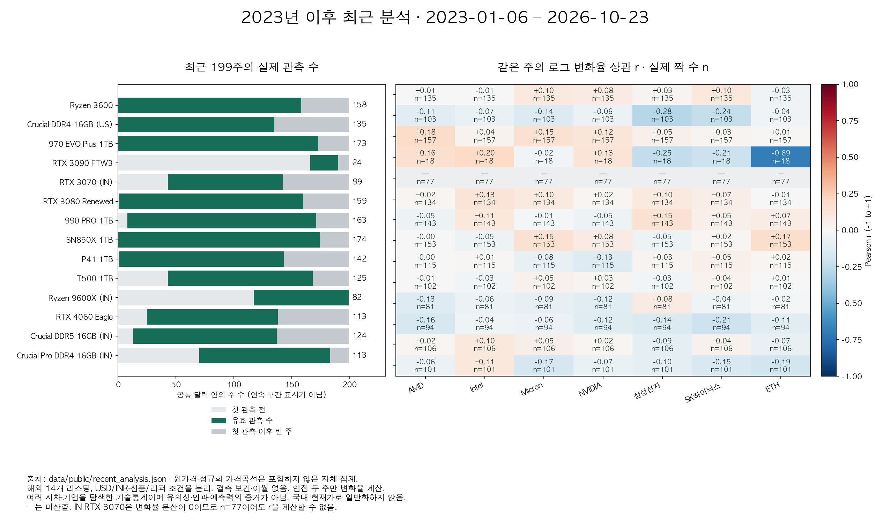

> 공개판 안내: 작성 당시 연구 기록입니다. 원가격·주가·벤치마크 원본과 복원 가능한 파일은 제외했습니다. 현재 공개 범위·실행법은 루트 README와 데이터 이용 안내를 따릅니다.

# 최근 부품·주가 분석과 최신성 감사

확인 기준: **2026-10-25 KST**. 최근 분석 달력: **2023-01-06–2026-10-23 (199주)**.
수집일·실제 호가일·주간 대표 날짜·예측 검증 기간을 구분한다. 공개판은 원가격 곡선 없이 자체 집계만 제공한다.

## 1. 실제 확보 범위

| 계열 | 시장·통화 | 유효 주 / 달력 | 인접 변화율 n | 주간 마지막 / 실제 호가 | 원출처 최신일 | 경과 일수 |
|---|---|---:|---:|---|---|---:|
| Ryzen 3600 | US·USD | 158 / 199 | 135 | 2026-10-09 / 2026-10-06 | 2026-10-06 | 19 |
| Crucial DDR4 16GB (US) | US·USD | 135 / 199 | 103 | 2026-10-16 / 2026-10-15 | 2026-10-15 | 10 |
| 970 EVO Plus 1TB | US·USD | 173 / 199 | 157 | 2026-10-02 / 2026-09-26 | 2026-09-26 | 29 |
| RTX 3090 FTW3 | US·USD | 24 / 199 | 18 | 2026-10-16 / 2026-10-13 | 2026-10-13 | 12 |
| RTX 3070 (IN) | IN·INR | 99 / 199 | 77 | 2026-10-23 / 2026-10-23 | 2026-10-24 | 1 |
| RTX 3080 Renewed | US·USD | 159 / 199 | 134 | 2026-10-16 / 2026-10-13 | 2026-10-13 | 12 |
| 990 PRO 1TB | US·USD | 163 / 199 | 143 | 2026-10-09 / 2026-10-07 | 2026-10-07 | 18 |
| SN850X 1TB | US·USD | 174 / 199 | 153 | 2026-10-16 / 2026-10-13 | 2026-10-24 | 1 |
| P41 1TB | US·USD | 142 / 199 | 115 | 2026-08-07 / 2026-08-07 | 2026-08-07 | 79 |
| T500 1TB | US·USD | 125 / 199 | 102 | 2026-10-16 / 2026-10-14 | 2026-10-14 | 11 |
| Ryzen 9600X (IN) | IN·INR | 82 / 199 | 81 | 2026-10-23 / 2026-10-23 | 2026-10-24 | 1 |
| RTX 4060 Eagle | US·USD | 113 / 199 | 94 | 2026-10-16 / 2026-10-13 | 2026-10-13 | 12 |
| Crucial DDR5 16GB (IN) | IN·INR | 124 / 199 | 106 | 2026-10-23 / 2026-10-23 | 2026-10-23 | 2 |
| Crucial Pro DDR4 16GB (IN) | IN·INR | 113 / 199 | 101 | 2026-10-23 / 2026-10-22 | 2026-10-24 | 1 |

원출처 최신일이 주간 마지막보다 늦을 수 있다. 10월 24일(토) 호가는 아직 완료되지 않은 다음 주에 속하므로 10월 23일 주간 분석에 넣지 않았다. 첫 관측 이전에는 미출시·미등록·미추적을 구분할 수 없으므로 이후 결측과 따로 표시한다.

| 시장 | 일별 n | 실제 마지막 거래/관측일 | 유효 주 / 달력 | 변화율 n |
|---|---:|---|---:|---:|
| AMD | 956 | 2026-10-23 | 199 / 199 | 198 |
| Intel | 956 | 2026-10-23 | 199 / 199 | 198 |
| Micron | 956 | 2026-10-23 | 199 / 199 | 198 |
| NVIDIA | 956 | 2026-10-23 | 199 / 199 | 198 |
| 삼성전자 | 927 | 2026-10-23 | 199 / 199 | 198 |
| SK하이닉스 | 927 | 2026-10-23 | 199 / 199 | 198 |
| ETH | 1392 | 2026-10-23 | 199 / 199 | 198 |

## 2. 부품–주가·ETH 동시 변화율 상관

같은 토–금 달력의 로그 변화율 Pearson r이다. 괄호는 실제 짝 수 n이며 제품 수를 독립 표본으로 합산하지 않는다. 시차 ±8주 전체 탐색표는 [CSV](../data/public/recent_correlations.csv)에 공개한다. p값·유의성·예측 신호를 주장하지 않는다. 인도 RTX 3070은 짝 수가 있어도 부품 변화율의 분산이 0이어서 상관계수를 계산할 수 없다(미산출은 r=0이 아님).

| 부품 | AMD | Intel | Micron | NVIDIA | 삼성전자 | SK하이닉스 | ETH |
|---|---:|---:|---:|---:|---:|---:|---:|
| Ryzen 3600 | +0.006 (135) | -0.005 (135) | +0.101 (135) | +0.079 (135) | +0.028 (135) | +0.104 (135) | -0.033 (135) |
| Crucial DDR4 16GB (US) | -0.115 (103) | -0.069 (103) | -0.139 (103) | -0.059 (103) | -0.282 (103) | -0.242 (103) | -0.037 (103) |
| 970 EVO Plus 1TB | +0.183 (157) | +0.039 (157) | +0.152 (157) | +0.125 (157) | +0.054 (157) | +0.027 (157) | +0.013 (157) |
| RTX 3090 FTW3 | +0.160 (18) | +0.199 (18) | -0.025 (18) | +0.128 (18) | -0.248 (18) | -0.213 (18) | -0.688 (18) |
| RTX 3070 (IN) | 미산출 (77) | 미산출 (77) | 미산출 (77) | 미산출 (77) | 미산출 (77) | 미산출 (77) | 미산출 (77) |
| RTX 3080 Renewed | +0.020 (134) | +0.126 (134) | +0.098 (134) | +0.021 (134) | +0.096 (134) | +0.069 (134) | -0.006 (134) |
| 990 PRO 1TB | -0.054 (143) | +0.109 (143) | -0.013 (143) | -0.055 (143) | +0.151 (143) | +0.049 (143) | +0.072 (143) |
| SN850X 1TB | -0.004 (153) | -0.051 (153) | +0.150 (153) | +0.081 (153) | -0.052 (153) | +0.023 (153) | +0.175 (153) |
| P41 1TB | -0.003 (115) | +0.014 (115) | -0.077 (115) | -0.126 (115) | +0.027 (115) | +0.051 (115) | +0.020 (115) |
| T500 1TB | -0.006 (102) | -0.029 (102) | +0.046 (102) | +0.027 (102) | -0.027 (102) | +0.036 (102) | +0.007 (102) |
| Ryzen 9600X (IN) | -0.131 (81) | -0.055 (81) | -0.086 (81) | -0.115 (81) | +0.082 (81) | -0.040 (81) | -0.019 (81) |
| RTX 4060 Eagle | -0.158 (94) | -0.039 (94) | -0.058 (94) | -0.118 (94) | -0.142 (94) | -0.207 (94) | -0.107 (94) |
| Crucial DDR5 16GB (IN) | +0.021 (106) | +0.105 (106) | +0.055 (106) | +0.016 (106) | -0.095 (106) | +0.041 (106) | -0.073 (106) |
| Crucial Pro DDR4 16GB (IN) | -0.057 (101) | +0.108 (101) | -0.167 (101) | -0.069 (101) | -0.096 (101) | -0.151 (101) | -0.187 (101) |

## 3. 최신 조회가 의미하는 것

2026-10-25T03:27:02+09:00에 해외 14개·시장 7개·국내 단면 8개를 다시 조회했다. 요청 성공과 현재 날짜까지의 이력 확보는 별개다.
Ryzen 3600은 2026-10-06, 970 EVO Plus는 2026-09-26에서 원출처 호가가 멈췄다. 이 두 구형 SKU만으로 현재 전체 PC 시장을 해석하지 않는다. 최근 제품의 이력·국내 현재 견적·검증된 미래 예측은 별도 근거다.
국내 견적의 sourceUpdatedOn은 미확인이다. 재조회 시점의 노출 견적이며 판매자의 재고·결제 가능 상태를 확인한 거래 가격이 아니다. 원견적 값과 원가격 시계열은 재배포 조건 미확인으로 공개 제외한다.
2020–2022년은 과거 채굴 붐 설명에, 2023–2026년은 최근 동향·상관 탐색에 사용한다. 두 기간의 계수를 서로 바꿔 인용하거나 2020–2022년의 204시차 보정 결과를 최근 기간에 적용하지 않는다.

## 4. 한계와 재현

- 해외 14개 리스팅의 호가이며 국내 현재가·전체 시장 지수가 아닙니다. 통화·지역·보드·신품/리퍼 조건이 다릅니다.
- 완료된 토–금 달력을 유지합니다. 첫 관측 전과 이후 결측을 구분하며 결측을 보간·이월하지 않습니다.
- 최근 13주 변화는 기술통계이며 달력 3개월 예측과 다릅니다. 양 끝 주에 실제 관측이 없으면 미산출입니다.
- 로그 변화율은 연속 두 주가 있을 때만 계산합니다. 양의 시차는 시장이 부품을 앞서는 방향입니다.
- 상관은 탐색 기술통계입니다. 다중비교 유의성·인과관계·예측력을 검증하지 않았고, 통화·환율·시차·신제품·재고를 통제하지 않았습니다.
- 국내 8개는 새로 조회한 단면 견적입니다. 월간 이력에 새 관측으로 붙이거나 구형 해외 제품으로 대체하지 않았습니다.
- 3개월 모델 비교는 2026-10-23 스냅샷으로 고정했습니다. 새 수집을 새 미래 검증 성과로 세지 않습니다.
- 2022년 머지 이후 ETH는 가격만 분석하며 PoW 채굴 수익 대용을 연장하지 않습니다.

공개 집계: [최근 분석 JSON](../data/public/recent_analysis.json) · [관측 수 CSV](../data/public/recent_coverage.csv) · [조회 메타데이터](../data/public/source_freshness.json).
수집: `scripts/refresh_report_sources.py --as-of 2026-10-25 --fetch` (새 경로에 한 번). 분석: `scripts/build_recent_report.py --as-of 2026-10-25` (저장된 원본이 있는 연구 환경).
공개판에서는 `scripts/plot_recent_report.py`로 집계 그림만 재생성할 수 있다. 기존 3개월 모델 비교·확률 보정·구매 추천 기준은 바꾸지 않았다.
